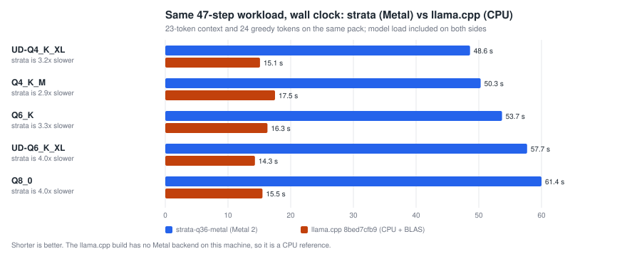

# Benchmarks on macpro51 (2026-11-22)

The Intel Mac in `docs/MAC.md` ("An Intel Mac"), branch `macpro51`, built from the branch tip:
`strata 0.1.59-metal`. Results now include a **llama.cpp reference on the same machine**, which is
what turns "it runs" into a statement about correctness.

| Family | Path | Result |
|---|---|---|
| Qwen3.6-35B-A3B | `build-metal/strata-q36-metal` | **runs**: 5 of 7 packs, 0.86 to 1.11 s per step — but only 2 of the 5 are correct |
| Qwen3.8-Flash-Next | `build-metal/strata` | **stops**: needs a 4.07 to 5.13 GiB Metal buffer; this card's limit is 3.5 GiB |
| DeepSeek V4.1-Flash | `build-metal/strata_ds4` | **refuses by design**: no Metal 3 device addresses on macOS 11 |

## Qwen3.6-35B-A3B, checked against llama.cpp

23-token context, 24 greedy tokens, identical token ids fed to both engines so they share one
tokenisation. llama.cpp returns the same 24 ids on **every** pack (bar one near-tie at the last
token), which is the behaviour of a faithful engine.

| Pack | gate/up, down | strata vs llama.cpp | s/step (mean of 3) |
|---|---|---|---|
| `Q8_0` | Q8_0, Q8_0 | **matches** | 1.114 |
| `UD-Q6_K_XL` | Q6_K, Q8_0 | **matches** | 1.039 |
| `Q6_K` | Q6_K, Q6_K | **wrong at token 4** | 0.986 |
| `Q4_K_M` | Q4_K, Q6_K | **wrong at token 4** | 0.940 |
| `UD-Q4_K_XL` | Q4_K, Q5_K | **wrong at token 4** | 0.864 |
| `UD-Q2_K_XL` | — | refused: the embedding is Q5_K | — |
| `UD-Q8_K_XL` | — | refused: the expert down tensor is BF16 | — |

The split tracks the **expert down-projection** type and nothing else: Q8_0 down is right, K-quant
down is wrong. So the three "K-group" answers are a bug, not a legitimate low-precision variant —
they should be treated as invalid output. This is the K-quant down-kernel fault first recorded on
2026-11-16; `be4cbc78f` did not fix it.

**Speed.** On the identical 47-step workload, wall clock including load:

| Pack | strata (Metal 2) | llama.cpp (CPU) |
|---|---|---|
| `UD-Q4_K_XL` | 45.1 s | 16.1 s |
| `Q4_K_M` | 47.3 s | 21.2 s |
| `Q6_K` | 50.0 s | 21.0 s |
| `UD-Q6_K_XL` | 53.3 s | 14.6 s |
| `Q8_0` | 56.5 s | 13.0 s |

A CPU build of llama.cpp beats the Metal path by 2.2 to 4.3 times. That is the readback fault
showing up as cost, and it means these Metal timings say nothing about what the card could do.

## What this is not

One prompt, one length, greedy only, no perplexity or KL measurement — a sharp but narrow test. No
Qwen3.8 or DeepSeek output exists for this machine. The llama.cpp build here has no Metal backend,
so its speed is a CPU reference. These are porting-validity figures on a 2010 Mac Pro with a Radeon
RX 580 (8 GB, Metal 2), not product performance and not comparable to the Apple Silicon or CUDA
numbers in `docs/MAC.md`.

Every number, refusal message and command is in
[`docs/macpro51-2026-11-22.md`](docs/macpro51-2026-11-22.md). The figures are produced, not
transcribed: `bench/macpro51/run_matrix.py` and `run_reference.py` write the two JSON files, and
`charts.py` and `charts_reference.py` draw the charts from them.

The earlier macpro51 pages (`docs/macpro51-test-results.md` and the three
`docs/qwen36-metal-*-benchmarks*.md` files) predate `be4cbc78f`, disagree with each other, and carry
a superseded banner; none of their token tables can be reproduced by the engine now.
