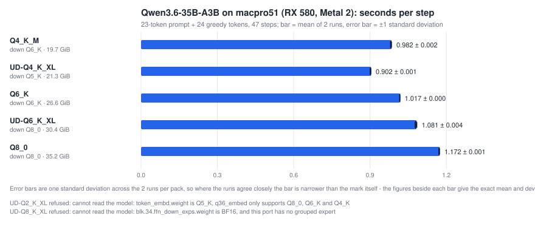

# Benchmarks on macpro51 (2026-11-22)

The Intel Mac in `docs/MAC.md` ("An Intel Mac"), branch `macpro51`, rebuilt at HEAD `be4cbc78f`:
`strata 0.1.59-metal`.

What it can and cannot do with the models that are on the machine, as measured on 2026-11-22:

| Family | Path | Result |
|---|---|---|
| Qwen3.6-35B-A3B | `build-metal/strata-q36-metal` | **runs**: 5 of 7 packs, 0.87 to 1.12 s per step, deterministic, readable text |
| Qwen3.8-Flash-Next | `build-metal/strata` | **stops**: needs a 5.13 GiB Metal buffer; this card's limit is 3.5 GiB |
| DeepSeek V4.1-Flash | `build-metal/strata_ds4` | **refuses by design**: no Metal 3 device addresses on macOS 11 |

## Qwen3.6-35B-A3B

23-token prompt, 24 greedy tokens, 47 steps, 8-slot expert pool, two runs per pack. `Q8_0` is the
reference answer.

| Pack | File | gate/up, down | s/step (run 1 / run 2) |
|---|---|---|---|
| `Q4_K_M` | 21.2 GB | Q4_K, Q6_K | 0.948 / 0.948 |
| `UD-Q4_K_XL` | 22.9 GB | Q4_K, Q5_K | 0.869 / 0.880 |
| `Q6_K` | 28.5 GB | Q6_K, Q6_K | 0.998 / 0.991 |
| `UD-Q6_K_XL` | 32.6 GB | Q6_K, Q8_0 | 1.048 / 1.052 |
| `Q8_0` | 37.8 GB | Q8_0, Q8_0 | 1.124 / 1.125 |
| `UD-Q2_K_XL` | 12.6 GB | — | refused: the embedding is Q5_K |
| `UD-Q8_K_XL` | 39.1 GB | — | refused: the expert down tensor is BF16 |

The two answers on the branch split exactly by the **down-projection** type: the two packs whose
down projection is Q8_0 return the `Q8_0` answer, and the three whose down projection is a K-quant
return a different one. That is the K-quant down-kernel fault already recorded on 2026-11-16, still
open.

This is not a correctness claim: no llama.cpp comparison was run on this day, and the parity check
that used to settle it (`expert_parity`) now stops at NaN in its own reference for real pack data,
including `Q8_0`. Both limits are written out in
[`docs/macpro51-2026-11-22.md`](docs/macpro51-2026-11-22.md), which also has the full numbers,
the refusal messages, the kernel checks and every command.

The figures are produced, not transcribed: `bench/macpro51/run_matrix.py` runs the matrix and writes
`bench/macpro51/results-qwen36.json`; `bench/macpro51/charts.py` turns that into
`docs/benchmarks/macpro51/decode-steps.csv` and the chart above.

## What this is not

These are porting-validity figures on a 2010 Mac Pro with a Radeon RX 580 (8 GB, Metal 2). They are
not product performance and are not comparable to the Apple Silicon or CUDA numbers in
`docs/MAC.md`. The earlier macpro51 pages (`docs/macpro51-test-results.md` and the three
`docs/qwen36-metal-*-benchmarks*.md` files) predate `be4cbc78f`, disagree with each other, and are
marked superseded; none of their token tables can be reproduced by the engine now.
