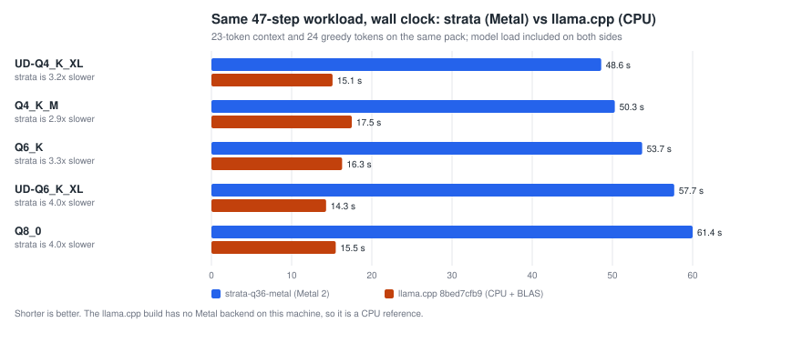
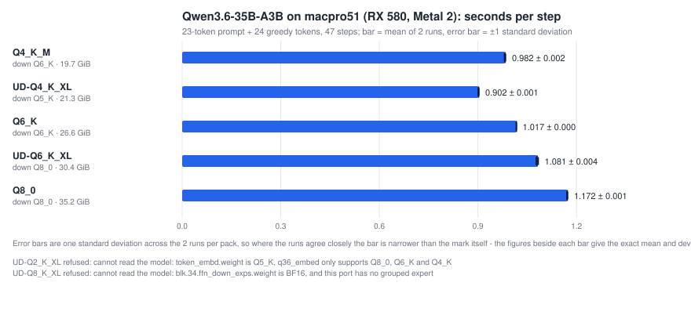

# macpro51: what the Strata engines do here, measured 2026-11-22

This page is the current record for the Intel Mac in `docs/MAC.md` ("An Intel Mac"). It replaces
the token tables in `docs/macpro51-test-results.md` (2026-11-16) and in the three
`docs/qwen36-metal-*-benchmarks*.md` pages: those were written before the engine changes in
`be4cbc78f`, and their numbers do not reproduce on the branch tip. Nothing below was copied from
them. Every figure came from a run made on 2026-11-22 with the build and commands shown, and the
charts are generated from the committed result files.

The short version: **the Qwen3.6 engine runs here, and all five runnable packs are correct.** A
llama.cpp reference on the same machine settles it. That was not always true — until 2026-11-22 the
three packs whose expert **down** projection is a K-quant returned a different answer, on a fault
fixed in `a2ad1da3e` and described under "Where the fault is" below.

## The machine and the build

| | |
|---|---|
| Host | MacPro5,1 ("macpro51"), macOS 11.7.11, 2 × Xeon X5675 (24 threads), ~96 GB DDR3 |
| GPU | AMD Radeon RX 580 8 GB, Metal 2, 64-lane simdgroups, max buffer 3758096384 B (3.5 GiB) |
| Repo | `~/projects/Strata/strata`, branch `macpro51`, built from the branch tip |
| Engine | `build-metal/strata-q36-metal`; `strata --version` prints `strata 0.1.59-metal` |
| Build | `PATH=/usr/local/bin:$PATH cmake --build build-metal -j 24` |
| Installed | `strata`, `strata-q36-metal`, `strata_ds4` in `/usr/local/bin`; `/usr/local/bin` added to PATH in `~/.zprofile` |
| Reference | llama.cpp rev `8bed7cfb9` at `~/projects/llama.cpp`, **CPU + BLAS** (that build has no Metal backend) |

`cmake` and `ninja` are in `/usr/local/bin` and are not on the non-interactive PATH, which is why
the build is spelled out.

## Method

**Strata side.** One engine process per run: the model is opened in place, the dense weights are
read into RAM, the experts are streamed from the SSD through an 8-slot arena, a 23-token prompt is
read and 24 tokens are generated greedily. Three runs per pack, in the order listed, so a slow pack
is not always measured first.

**Reference side.** `bench/macpro51/run_reference.py` feeds the *same 23 token ids* (not text, so
both engines start from one tokenisation) to a small helper linked against llama.cpp, which prints
the greedy continuation as token ids. Two runs per pack. Because both sides take ids and return
ids, they are compared id for id.

The prompt is *"Explain, in two short sentences, why the sky looks blue during the day and red at
sunset."*, which the engine tokenises to
`3 1 42498 456 11 303 1330 2716 22157 11 3069 279 12515 5686 6105 2261 279 1834 321 2438 506 41564 13`.

The reference tool is `bench/macpro51/llama_ref.cpp` in this repo, built against that llama.cpp
checkout (the build line is under "Commands"). It takes ids and returns ids, greedy by argmax with no
sampler, so nothing about it depends on a seed. It was cross-checked on `Q8_0` against the opaque
`~/q36_llama_dump` binary the first round used, and returns the identical 24 ids.

That llama.cpp build has no Metal backend, so this is a **CPU** reference, and it ran with the page
cache warm from the strata runs just before it, which is why its wall-clock figures are as good as
they are.

## The reference comparison

llama.cpp returns **the same 24 ids on all five packs**:

```
271 248068 198 8160 579 264 7047 1817 25 271 16 13 220 2972 2014 53983 2570 5396 64700 198 256 471 2972 14162
```

The single exception is `Q4_K_M`, whose last token is `25562` instead of `14162`: a near-tie between
two tokens at position 24, after 23 identical positions. Quantisation does not otherwise change the
answer here, which is what you expect of a faithful engine.

Strata agrees on two packs and parts company at token 4 on three:

| Pack | gate/up, down | strata | llama.cpp | Verdict |
|---|---|---|---|---|
| `Q8_0` | Q8_0, **Q8_0** | `... 198 8160 579 ...` | identical | **matches** |
| `UD-Q6_K_XL` | Q6_K, **Q8_0** | `... 198 8160 579 ...` | identical | **matches** |
| `Q6_K` | Q6_K, **Q6_K** | `... 198 8160 579 ...` | identical | **matches** \* |
| `Q4_K_M` | Q4_K, **Q6_K** | `... 198 8160 579 ...` | identical | **matches** \* |
| `UD-Q4_K_XL` | Q4_K, **Q5_K** | `... 198 8160 579 ...` | identical | **matches** |

\* the last token is `25562` where the other packs give `14162`, a near-tie at position 24; llama.cpp's own `Q4_K_M` shows the same split.

All five packs now agree with llama.cpp. That is new: until 2026-11-22 the three K-quant-down packs
diverged at token 4, on the fault the 2026-11-16 page recorded as "the DNK path for the K-quant down
kernel" (`y rel L2 4.58e+06`). `be4cbc78f`'s "K-quant kernel fixes" did not fix it, and it was real —
just not where the page guessed.

**The cause.** `moe_gu` and `moe_down` map the hardware simdgroup ids through the runtime's
`sg32()`/`lane32()`, which express a tile's own 32-lane group. `moe_down_k` — the kernel a K-quant
down uses — took the raw `[[simdgroup_index_in_threadgroup]]` and `[[thread_index_in_simdgroup]]`
instead. On a 32-lane GPU those are the same thing, which is why it never showed on Apple silicon.
This card has 64-lane simdgroups, so a 128-thread threadgroup is two hardware groups, not four, and
the row formula produced group indices 0..7 and 4..11: overlapping, and never reaching 12..15. Rows
24..31 of every threadgroup were never written — a quarter of the output, hence a relative L2 of
`sqrt(0.25) = 0.5`. Three lines, the same ones the neighbouring kernels already had, fix it.

**How far off, in logits.** Token identity says *that* two packs differ; it does not say by how
much. `bench/macpro51/logit_distance.py` dumps the engine's own logits for the same 23 token ids on
two packs and reports the distance at each predicted position. Over the 22 positions:

| Pair | median RMS before | after | argmax (before / after) |
|---|---|---|---|
| `Q8_0` vs `UD-Q6_K_XL` — Q8_0 down, the reference floor | 0.095 | **0.095** | 22/22 · 22/22 |
| `Q8_0` vs `UD-Q4_K_XL` — down is Q5_K | 0.977 | **0.170** | 17/22 · 21/22 |
| `Q8_0` vs `Q6_K` — down is Q6_K | 1.053 | **0.289** | 15/22 · 19/22 |
| `Q8_0` vs `Q4_K_M` — down is Q6_K | — | **0.296** | — · 21/22 |

"Before" is the defective kernel; "after" is commit `a2ad1da3e`. The pack whose down is Q8_0 is
unchanged, as it should be — the fix only touches the K-quant path.

The residual 0.17 to 0.30 is not a defect. It is what coarser **down** weights cost: the down matrix
has four times the output width of the gate/up, so quantising it to Q6_K or Q5_K moves the logits
more than quantising the gate/up does. The token-level check settles it — all four packs now return
llama.cpp's own answer, so this residual is legitimate quantisation error, not error in the engine.

That also explains why the first three generated tokens survive the fault: the argmax still agrees
at most positions, so a greedy decode can coast for a few steps before a ~1-logit error flips a
choice. Token identity alone would have understated the damage.

**Where the fault is.** A K-quant expert's down projection is dispatched to `moe_down_k`, not to the
generic `moe_down`. `metal/kernels/moe.metal` registers the K-quant downs (`Q4_K`, `Q5_K`, `Q6_K`,
`Q3_K`) under the `DNK` macro inside `#ifdef STRATA_KQ_DOWN`, and that kernel builds its input slices
from the raw `h` row (`XD<F>`) rather than from the prepared `xprep` planes the gate/up path reads
(`X<F>`). The gate/up side of these packs is sound — `UD-Q6_K_XL` runs Q6_K gate/up and matches
llama.cpp exactly — so the decoder is not the problem, and the fault sits in the down kernel's input
path. That is where the next fix belongs.

`expert_parity` is the tool that located it. Run on synthetic blocks — no `--gguf`, no file
offsets — it isolates the fault, and on real pack data it now does too (the NaN that used to make
it useless was its own 512-expert assumption; see "The kernel checks" below):

```
parity Q8_0/Q8_0 ... h rel L2 1.52e-07  y rel L2 1.15e-07   PASS
parity Q6_K/Q6_K ... h rel L2 2.86e-07  y rel L2 1.26e+00   FAIL
parity Q8_0/Q6_K ... h rel L2 1.52e-07  y rel L2 1.29e+00   FAIL
```

Read those rows together and the fault is pinned: with the gate/up either `Q8_0` or `Q6_K` the `h`
error stays at 3e-07, so the gate/up path and the `Dec<T_Q6_K>` decoder behind it are exact. The
`y` error is 1.26 to 1.29 either way, and a relative L2 of about 1 is what an output *uncorrelated*
with the reference gives (`0` would score 1.0). So the Q6_K **down** projection is simply not
computing the right thing, and it is not the decoder.

It is also not the tile: sweeping every down configuration (`--dncfg` over 8,1,4 / 8,2,4 / 8,4,4 /
4,1,4 / 4,2,4 / 16,1,4 / 16,2,4 / 32,1,4 / 2,2,4) moves `y` only from 1.25 to 1.27, so the error is
systematic rather than a bad tiling. What is left is `moe_down_k`'s input path, and the fastest way
to settle it is to make the host prepare the `h` planes and dispatch the generic `moe_down` (which
is known good, since it serves the Q8_0 down) instead of `moe_down_k`; if that passes, `XD<F>` is
the defect and the plane path is the fix.

The llama.cpp comparison above remains the end-to-end oracle.

## Speed on the same workload

Same packs, same 23-token context, same 24 greedy tokens, wall clock including the model load:

| Pack | strata (Metal 2) | llama.cpp (CPU) | strata is |
|---|---|---|---|
| `UD-Q4_K_XL` | 48.6 s | 15.1 s | 3.2× slower |
| `Q4_K_M` | 50.3 s | 17.5 s | 2.9× slower |
| `Q6_K` | 53.7 s | 16.3 s | 3.3× slower |
| `UD-Q6_K_XL` | 57.7 s | 14.3 s | 4.0× slower |
| `Q8_0` | 61.4 s | 15.5 s | 4.0× slower |



The CPU reference beating the Metal path by 2.9 to 4.0 times is the readback fault showing up as cost: a
port that has to shuffle results through the CPU view cannot compete with one that does not. It also
means these Metal timings say nothing about what this card could do.

Strata's per-step figures (47 steps; prompt read included) across the three runs:

| Pack | Run 1 | Run 2 | Run 3 | Mean |
|---|---|---|---|---|
| `Q4_K_M` | 1.014 | 0.995 | 1.014 | **1.008 s/step** |
| `UD-Q4_K_XL` | 0.930 | 0.919 | 0.959 | **0.936 s/step** |
| `Q6_K` | 1.057 | 1.046 | 1.050 | **1.051 s/step** |
| `UD-Q6_K_XL` | 1.264 | 1.146 | 1.105 | **1.172 s/step** |
| `Q8_0` | 1.376 | 1.194 | 1.188 | **1.253 s/step** |



The runs of a pack agree to within 0.19 s/step in this set (run 1 is always the slowest: the machine
had just been rebooted, so nothing was in the page cache; the earlier warmer session managed 0.037).
`Q8_0`, whose down kernel the fix does not touch, moved by the same ~10%, so the shift from the
pre-fix numbers is machine state, not the fix. The reference walls agree less tightly, from
0.0 to 2.1 s run to run, though its token ids are identical every time; on this workload the strata
side is the more repeatable of the two. Strata's step figures exclude the model load; the wall-clock
table above includes it on both sides.

## The two packs that refuse

Both stop in about a second and name the tensor, so a refusal is a result, not a crash:

| Pack | File | Refusal |
|---|---|---|
| `UD-Q2_K_XL` | 12.6 GB (11.7 GiB) | `token_embd.weight is Q5_K, q36_embed only supports Q8_0, Q6_K and Q4_K` |
| `UD-Q8_K_XL` | 39.1 GB (36.4 GiB) | `blk.34.ffn_down_exps.weight is BF16, and this port has no grouped expert down kernel for that type (it takes: Q8_0, Q5_0, Q5_1, IQ4_NL, IQ4_XS, IQ3_S and Q2_0)` |

## The other two families

### Qwen3.8-Flash-Next: two packs tried, both stop on a buffer this card cannot allocate

The Qwen3.8 path is the `strata` binary (`strata generate --pack DIR`). Both attempts load their
pack and come up, then fail on `mtl: alloc_shared`, at two different sizes:

| Pack | Dense loaded | Failing allocation | Card limit |
|---|---|---|---|
| `UD-Q4_K_XL` (82.5 GB) | 1416 MiB + 2975 MiB native | `5505597440` = 5.13 GiB | 3.5 GiB |
| `UD-IQ1_M` (39.2 GB) | 1466 MiB + 2342 MiB native | `4375363584` = 4.07 GiB | 3.5 GiB |

The smaller pack asks for less, so this is not a fixed constant, but even the smallest Qwen3.8 pack
on the machine is above the ceiling. The `UD-IQ1_M` attempt also showed that the PLE table for that
pack is in shard 3, not shard 2 — `--ple-gguf` names the shard that holds
`per_layer_token_embd.weight`, and shard 1 and shard 2 both refuse with that message.

No Qwen3.8 output exists for this machine.

### DeepSeek V4.1-Flash: refuses before it starts

`strata_ds4` with the `maya-ds4` pack (IQ1_M/IQ2_XXS, 40 layers × 384 experts, 6 used) exits in
0.01 s without touching the GPU:

```
maya-ds4: this Mac's Metal has no device addresses (macOS 13's gpuAddress) and no residency set, which this
engine's Metal path needs: its kernels take raw pointers, its copies and dispatches share two queues, and on
this card that has reset the GPU and hung the machine. It is not run here.
  STRATA_DS4_ALLOW_UNSTABLE_METAL=1 tries anyway (results are not to be trusted; expect GPU resets).
```

The unsafe flag was **not** set. `--pack-info` works without the GPU:

```
pack-info .../maya-ds4
  40 layers x 384 experts, 6 used; dim 5120, ff 2304, vocab 129280
  layer 0   IQ1_M/IQ1_M     7741440 B/expert   46.45 MB/token
  layer 10  IQ2_XXS/IQ2_XXS 9123840 B/expert   54.74 MB/token
```

## Kernel checks, same build

**`runtime_hello` — 4 of 4 checks fail.** The readback limit `docs/MAC.md` describes is still here:

```
FAIL ...: a device pointer is a GPU address, not the CPU view
FAIL ...: step 1: 65470 wrong values
FAIL ...: graph replays: 65536 wrong values
FAIL ...: mapped: 65470 wrong
RESULT: 4 FAILED
```

The dispatch side is healthy in the same run: a 1000-dispatch window replays in 0.41 to 0.95 ms
(encode and commit) and completes in 5.50 to 6.48 ms; 5019 dispatches over 14 command buffers.

**`expert_parity` on real pack data works, and confirms the down fix against real weights.** Until
`150d58368` this path reported `h rel L2 nan` on every pack, which is why the earlier rounds fell
back to synthetic blocks. The cause was not the dequantiser and not the offsets: the harness
hardcoded **512 experts** in two places (`rng.next() % 512` when picking which experts to copy into
the blob, and `args_for(K, ntok, 512)`), while these packs have **256**. Half the picks therefore
indexed past the end of the `ffn_*_exps` tensor and copied whatever followed it, and that junk
sometimes decoded to NaN. The count now comes from the tensor itself,
`tg_->bytes / (L.gu_row * N_FF)`.

At the model's real width (`--ff 512 --embd 2048`, which is itself required — the default `N_FF` is
640 and a K-quant block is 256 values, so at the default the check reads past the last block):

```
Q8_0 pack   h 1.43e-07   y 1.03e-07   PASS
Q6_K pack   h 3.11e-07   y 2.06e-07   PASS
```

**Every runnable pack now passes on real pack data, both halves.** `747991cba` fixed the last of
it: the harness's `xkind()` returned 0 for Q4_K and Q5_K, with a comment claiming they "use plane 0
(raw)", while `units.metal` has `XKind<T_Q4_K>` and `XKind<T_Q5_K>` at `XK_P4` (plane 2) and
`Dec<T_Q4_K>` extracts codes with an unshifted `bytes4` mask — which only works against the
2^-8/-16/-24 scaled plane. Fed raw x, each term was multiplied by up to 2^24, and that is the
`h rel L2 ~1e14` the gate/up check had reported for those two types since the harness was written.
It was a harness bug all along, which is why the engine and the harness disagreed about Q4_K.

With `xkind()` corrected:

| Pack | gate/up (h) | down (y) | |
|---|---|---|---|
| `Q8_0` | 1.43e-07 | 1.03e-07 | PASS |
| `Q6_K` | 3.11e-07 | 2.06e-07 | PASS |
| `Q4_K_M` | 2.87e-07 | 2.48e-07 | PASS |
| `UD-Q4_K_XL` | 2.78e-07 | 1.74e-07 | PASS |
| `UD-Q6_K_XL` | 3.06e-07 | 1.05e-07 | PASS |

and synthetic `--gu Q4_K --dn Q4_K` went from failing at ~5e14 to `y 5.50e-08 PASS` (Q5_K 5.24e-08).
So the K-quant down fix is confirmed against the model's own weights, and the gate/up check is now
trustworthy for every type it can run.

**The dequantiser is not the cause.** `dsu_ref_vs_ggml` compares `ref_quant.cpp` against ggml's own
`to_float` block for block; it covered four types (IQ1_S, IQ1_M, Q6_K, IQ2_XXS) and now covers
Q4_K, Q5_K, Q3_K and Q8_0 as well. All eight agree with ggml bit for bit, 0 of 131 072 values
different.

## Engine source: the `DEBUG:` scaffolding is gone

`be4cbc78f` committed unconditional `DEBUG:` output in two files. Both are cleaned, and nothing else
about the engine changed:

* `metal/tests/expert_parity.cpp` — six debug blocks (weight, activation and per-entry dumps) that
  printed on every parity run. Removed.
* `metal/src/qwen36/q36_engine.cpp` — one unguarded start-up dump of tensor types. Removed. This
  file is not referenced by the build at all (`build.ninja` has no rule for it), so it is dead code;
  the edit is tidiness, not behaviour.

Kept on purpose: the `Q36_TRACE`-guarded block in `metal/src/qwen36/q36_dense.cpp` (opt-in
instrumentation, off unless that variable is set), and the explanatory `// DEBUG:` comment in
`src/program/generate.cpp`, which is prose rather than code.

Regression check after the rebuild: the engine still prints `strata 0.1.59-metal`, and `Q8_0` on the
full 23-token context still opens with `271 248068`, exactly as before.

## Not run, and therefore not claimed

* **No long-context or batched run.** One prompt of 23 tokens, one 24-token decode, one 8-slot pool.
  Multi-thousand-token context, `--parallel`, `--spec` beyond the default, and the vision projector
  were not exercised.
* **No Qwen3.8 or DeepSeek output** — both stop before the first token, for the reasons above.
* **No perplexity or KL measurement.** The comparison is greedy token identity on one prompt, which
  is a sharp but narrow test: it would not catch an error that kept the argmax while shifting the
  distribution.
* **The reference is CPU-only.** A llama.cpp with its Metal backend would be the fair speed
  comparison, and that build has none.
* These are **porting-validity figures, not product performance.** One RX 580 with 8 GB and a 2010
  Xeon is not a platform Strata ships for.

## Commands

```sh
cd ~/projects/Strata/strata
PATH=/usr/local/bin:$PATH cmake --build build-metal -j 24

python3 bench/macpro51/run_matrix.py --runs 3        # strata  -> results-qwen36.json
python3 bench/macpro51/run_reference.py --runs 2     # llama.cpp -> results-reference.json
python3 bench/macpro51/charts.py                     # s/step chart + CSV
python3 bench/macpro51/charts_reference.py           # wall-clock comparison chart + CSV
python3 bench/macpro51/logit_distance.py --ref Q8_0 --test Q6_K   # distance, in logits

# one pack by hand
./build-metal/strata-q36-metal --model ~/models/qwen36/Qwen3.6-35B-A3B-Q8_0.gguf \
    --prompt "Explain, in two short sentences, why the sky looks blue during the day and red at sunset." \
    --n 24 --text

# the reference, same ids
DYLD_LIBRARY_PATH=~/projects/llama.cpp/build/bin ~/q36_llama_dump \
    --model ~/models/qwen36/Qwen3.6-35B-A3B-Q8_0.gguf \
    --tokens 3,1,42498,456,11,303,1330,2716,22157,11,3069,279,12515,5686,6105,2261,279,1834,321,2438,506,41564,13 \
    --n 24

# Qwen3.8 (stops on the buffer, above)
STRATA_METAL_STREAM=1 ./build-metal/strata --pack ~/models/qwen38/UD-IQ1_M/pack \
    --native ~/models/qwen38/UD-IQ1_M/UD-IQ1_M-metal.gguf \
    --native-dense-gguf ~/models/qwen38/UD-IQ1_M/UD-IQ1_M-metal.gguf \
    --ple-gguf ~/models/qwen38/UD-IQ1_M/Qwen3.8-Flash-Next-UD-IQ1_M-00003-of-00003.gguf \
    --tokens 3,1,42498,456,11 --max-new 4 --max-context 512 \
    --spec 2 --suffix-draft 0 --lookup-max-t 0 --prefill 5

# DeepSeek V4.1 (refuses, above)
./build-metal/strata_ds4 --pack ~/models/deepseek-v4.1-flash/maya-ds4 --ids 671,6102,294 --n 8

# kernel checks
./build-metal/runtime_hello
./build-metal/expert_parity --gguf ~/models/qwen36/Qwen3.6-35B-A3B-Q8_0.gguf --layer 0 --ntok 1
```
