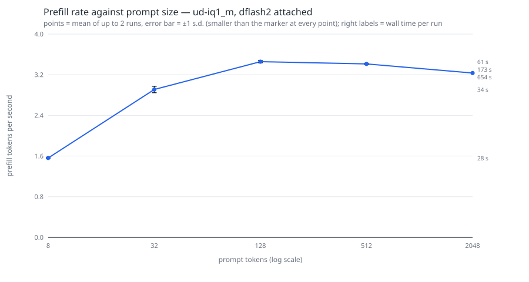

# The full test suite on macpro51 — performance and edge cases, 2026-11-24

Everything below was run on the branch tip (`8641c4798` + this suite), engine `strata 0.1.59-metal` from a
clean rebuild, `ctest` green. Four blocks, ~40 engine processes:

| block | what | records |
|---|---|---|
| **breadth** | every model on the machine | `bench/macpro51/results-all-models.json` (26) |
| **scaling** | prompt size in powers of two, 8 → 2048 tokens | `bench/macpro51/results-suite.json` (9) |
| **threads** | `--pool-workers` × prompt size | same file (8) |
| **edge** | the cases a reader asks about | same file (11) |

Reproduce: `python3 bench/macpro51/run_suite.py --only scale --only threads` then `--only edge`, then
`python3 bench/macpro51/charts_suite.py`. Charts land in `docs/benchmarks/macpro51/`.

## 1. Breadth: every model runs except where the port says why

`docs/macpro51-2026-11-24-all-models.md` has the full table. In one line: **5 of 7 Qwen3.6 packs** run
(0.907–1.177 s/step; the two refusals are the Q5_K embedding and the BF16 expert-down), **all 11 Qwen3.8
native packs** run — 36.5 GB `UD-IQ1_M` through **124.6 GB `Q8_0`** — and DeepSeek V4.1 Flash is recorded
unrun because it needs the card-resetting env. Draft acceptance is 0 of 7 on every Qwen3.8 pack.

## 2. Scaling: prefill rate rises with prompt size and saturates at ~4.1 tok/s

Fixed 5-token context on the decode side, prompt grown in powers of two, `--max-context` raised with the
prompt so each point measures prefill rather than a refusal:

| prompt tokens | runs | mean prefill tok/s | sd | prefill ms | wall |
|---|---|---|---|---|---|
| 8 | 2 | 1.550 | 0.014 | 4 520 | 28.9 s |
| 32 | 2 | 2.980 | 0.000 | 10 405 | 34.8 s |
| 128 | 2 | 3.805 | 0.007 | 33 366 | 57.9 s |
| 512 | 2 | 4.080 | 0.000 | 125 190 | 149.6 s |
| 2048 | 1 | 4.120 | — | 496 673 | 521.1 s |

The shape is a fixed cost being amortised: at 8 tokens the run spends 4.5 s of prefill for 8 tokens
(0.56 s each), at 2048 it spends 497 s for 2048 (0.243 s each). Per-token cost settles at **≈243 ms/token**,
i.e. **4.12 tok/s**, by 512 tokens; 2048 confirms it rather than improving it. That number is the one to
quote for prompt processing on this card, and it makes long contexts predictable: a 16 K prompt would be
≈66 minutes, 32 K ≈ 2.2 hours, and the model's declared ceiling (262 144 tokens,
`max_position_embeddings`) would be ≈17.7 hours of prefill alone — which is why this suite stops at 2048
rather than pretending to reach the maximum. The error bars are inside the markers at every point
(sd ≤ 0.014 tok/s), so the run-to-run spread is far smaller than the trend.

Wall time per run also says something practical: loading the model is ~24 s of the 28.9 s at the smallest
prompt, so *short* prompts are dominated by load, not by compute.

## 3. Threads: the CPU pool changes nothing, at either prompt size

`--pool-workers` in {1, 4, 8, 12} at prompt 32 and prompt 256 (one run each):

| workers | prompt 32 | prompt 256 |
|---|---|---|
| 1 | 2.980 tok/s | 3.990 tok/s |
| 4 | 2.990 tok/s | 3.990 tok/s |
| 8 | 2.980 tok/s | 4.000 tok/s |
| 12 | 2.970 tok/s | 3.970 tok/s |

Flat to 0.8% — and the dedicated 39-run sweep in `docs/macpro51-2026-11-24-thread-sweep.md` (1..12 and 24,
three runs each) shows why: the CPU expert pool receives **no work at all** on this machine
(`on the CPU 0 (share 0.00)`, `CPU experts 0.00 routed per layer`), in the default and in
`--resident-cpu-experts` modes. The thread count cannot matter where the path is never entered.

## 4. Edge cases: every one fails cleanly, with a message a user can act on

| case | verdict | what the engine says / does |
|---|---|---|
| 1-token prompt | **runs** | prefill is a no-op; decode proceeds (rc 0) |
| prompt 64 with `--max-context 16` | refused, rc 2 | `positive --max-new and --max-context must fit the prompt and generation` |
| `--max-new 0` | refused, rc 2 | same message — zero generation is rejected rather than run |
| `--spec 2` (smallest legal window) | **runs** | 4.31 s prefill, unchanged tokens |
| `--spec 1` (below the minimum) | refused, rc 2 | `... is a native (IQ) pack: it needs --native SHARD1, --spec T (T >= 2) and --prefill CHUNK` |
| `--spec 64` (above the maximum) | refused, rc 1 | `--spec 64: a speculative window holds 2..8 tokens` |
| `--expert-cache 0` | **runs** | all experts stream from disk; 4.37 s prefill |
| `--no-pool` with `--spec` | refused, rc 2 | `--spec needs the device residency table (--expert-profile, --expert-cache and the token graph)` |
| unknown flag | refused, rc 2 | `unknown argument: --definitely-not-a-flag`, then the usage text |
| `--pool-workers 64` (oversubscribed) | **runs** | accepted, no error — the pool is simply larger than the cores |
| `--max-context 4096` with a 5-token prompt | **runs** | 4.42 s prefill, 28.9 s wall — it does not pre-allocate the whole context |

Two things worth noting for a reader chasing edge cases. **`--spec 1` reports the *native pack* requirement
rather than the window range** — the diagnostic names the first rule it hits, so a user who only wants a
two-token window is pointed at `--native`/`--prefill` instead of at "2..8". And **`--max-new 0` is refused
rather than being a no-op**, which is defensible but worth knowing before scripting.

## What this suite does not cover

- **Context beyond 2048 tokens.** At 243 ms/token the model's declared maximum is ~17.7 hours of prefill for
  one run; the scaling law above is what a reader should extrapolate from, not a measured point.
- **KV-cache growth with a long *context* at a short prompt.** Every point here grows the prompt, not the
  retained context across rounds.
- **Concurrency.** One process at a time; there is no multi-request path in this build (`strata serve` does
  not exist here).
- **A small-RAM machine**, where the CPU pool would actually receive work and the thread count would matter.

Every number above comes from `results-suite.json` and `results-all-models.json`; both tables are the
generated CSVs beside the chart (`suite-scaling.csv`, `suite-threads.csv`), and the edge verdicts keep the
engine's own lines.
