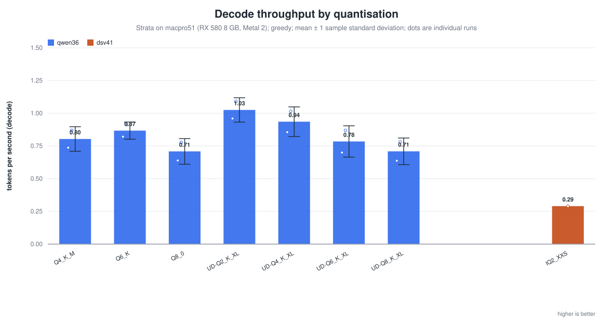
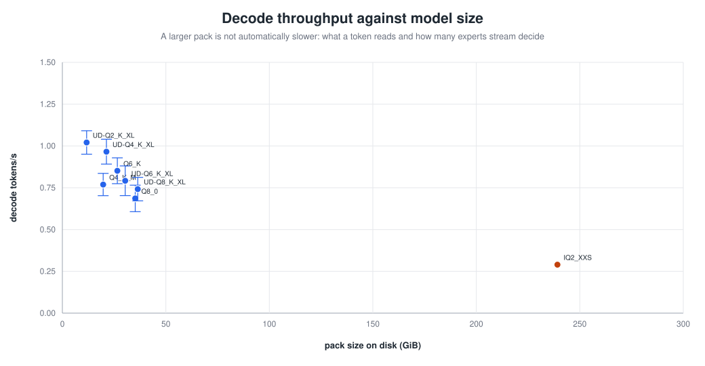
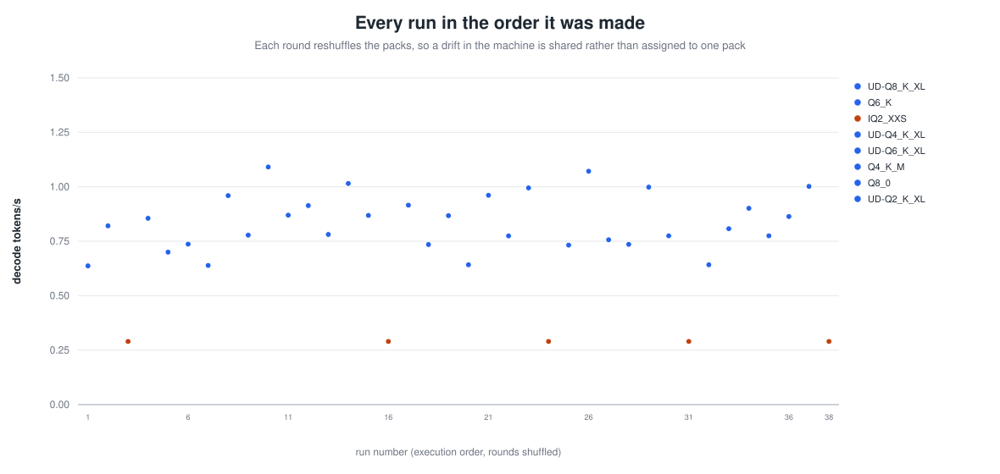

# Strata quantisation benchmarks on macpro51 (Intel Mac Pro, Radeon RX 580)

_Generated 2026-11-18 10:06 UTC by `bench/macpro51/run_bench.py`. Every number below was produced on the machine named here, during this sweep._

## The machine

| | |
| --- | --- |
| Mac | MacPro5,1, 2 × 6-core Xeon X5675 (12 cores / 24 threads), 128 GB DDR3 ECC |
| GPU | AMD Radeon RX 580, 8 GB, Metal 2 (no Metal 3, no bf16, no device addresses) |
| OS | macOS 11.7.11 (Big Sur, 20G1443) |
| Engine | `strata-q36-metal` (Qwen3.6) and `strata_ds4` (DeepSeek V4.1-Flash), built Release with Ninja |
| Branch / commit at the last run | `macpro51` / `2c4ac2dcd7` |

The Metal runtime here is the workaround path: kernels take buffer offsets instead of raw device addresses, the DeepSeek engine flushes command buffers one at a time (`DS4_FLUSH_EVERY`), and `simdgroup_matrix`/Metal 3 features are skipped. Numbers are therefore this card's, not a Metal 3 Mac's.

## What ran, and what could not

Strata's three public families are DeepSeekV4.1-Flash-1017, Qwen3.8-Flash-Next and Qwen3.6-35B-A3B. This branch's Metal engine has paths for Qwen3.6 (`src/qwen36`) and DeepSeek V4.1-Flash (`src/dsv41`); Qwen3.8 has no Metal path here and the docs place it on Apple silicon, so it is not runnable on this Intel Mac. Every installed pack of the two runnable families was tested.

| Family | Pack | On disk | Result |
| --- | --- | ---: | --- |
| qwen36 | Q4_K_M | 19.7 GiB | 5 run(s), 0.79 tok/s decode |
| qwen36 | Q6_K | 26.6 GiB | 5 run(s), 0.86 tok/s decode |
| qwen36 | Q8_0 | 35.2 GiB | 5 run(s), 0.70 tok/s decode |
| qwen36 | UD-Q2_K_XL | 11.7 GiB | 4 run(s), 1.02 tok/s decode |
| qwen36 | UD-Q4_K_XL | 21.3 GiB | 5 run(s), 0.97 tok/s decode |
| qwen36 | UD-Q6_K_XL | 30.4 GiB | 4 run(s), 0.79 tok/s decode |
| qwen36 | UD-Q8_K_XL | 36.4 GiB | 5 run(s), 0.75 tok/s decode |
| dsv41 | IQ2_XXS | 239.2 GiB | 5 run(s), 0.29 tok/s decode |
| dsv41 | UD-Q8_K_XL | — | refused: the dense weights (attention, shared experts, output head) need 15.61 GB of VRAM and the RX 580 has 8.59 GB |

Two Qwen3.6 packs were refused when this sweep started, and the refusals were real defects rather than hardware limits; they were fixed on the branch before the sweep (see [Engine fixes](#engine-fixes)). The DeepSeek UD-Q8_K_XL pack is refused by the engine on this card because its dense weights alone need 15.61 GB of VRAM against the RX 580's 8.59 GB; that is a hardware limit, recorded here rather than worked around.

## Method

- **One process per run.** The engine loads the model, warms every pipeline with one full pass, resets the sequence state in place, then times a fresh pass. Model load time is reported separately and is not part of either throughput.
- **Fixed workload.** Qwen3.6: 32 prompt tokens read one at a time, then 32 greedy tokens. DeepSeek: 16 prompt tokens, then 16 greedy tokens, with its own chunked prompt path and its reported prompt/decode times. The same token ids are used for every pack of a family.
- **Mixed order.** Each round contains every runnable pack once, in a fresh shuffled order (seed in `bench/macpro51/meta.json`). No pack is always first or always last, so thermal or page-cache drift is spread across the matrix.
- **Error bars.** Mean ± 1 sample standard deviation over the completed runs of that pack; the individual runs are drawn as dots on the charts. With 5 rounds the bars describe run-to-run spread on this machine, not a confidence interval for another one.
- **Steady state.** Qwen runs use a 2 GiB expert-slot budget, which selects the streaming path for every pack here; the warm-up pass is what fills the OS page cache and compiles the pipelines before the first measured token.

## Decode throughput



| Family | Pack | Runs | Decode tok/s (mean ± sd) | Range | Prefill tok/s (mean ± sd) |
| --- | --- | ---: | ---: | ---: | ---: |
| qwen36 | Q4_K_M | 5 | 0.79 ± 0.07 | 0.73 – 0.87 | 0.94 ± 0.00 |
| qwen36 | Q6_K | 5 | 0.86 ± 0.07 | 0.76 – 0.92 | 0.97 ± 0.02 |
| qwen36 | Q8_0 | 5 | 0.70 ± 0.08 | 0.64 – 0.81 | 0.86 ± 0.01 |
| qwen36 | UD-Q2_K_XL | 4 | 1.02 ± 0.07 | 0.96 – 1.09 | 1.14 ± 0.01 |
| qwen36 | UD-Q4_K_XL | 5 | 0.97 ± 0.07 | 0.86 – 1.02 | 1.07 ± 0.01 |
| qwen36 | UD-Q6_K_XL | 4 | 0.79 ± 0.09 | 0.70 – 0.87 | 0.93 ± 0.01 |
| qwen36 | UD-Q8_K_XL | 5 | 0.75 ± 0.06 | 0.64 – 0.78 | 0.83 ± 0.00 |
| dsv41 | IQ2_XXS | 5 | 0.29 ± 0.00 | 0.29 – 0.29 | 0.48 ± 0.00 |

## Prompt (prefill) throughput


Prefill is read one token at a time by the Qwen engine, so it is a per-token latency measurement as much as a bandwidth one; the DeepSeek engine reads its prompt in chunks. The two families are therefore comparable within themselves, not to each other.

## Size against speed



On this card a token streams its routed experts from RAM/SSD through an 8 GB window, so the pack's size is only one of the things that decide its speed: the number of bytes a token actually reads, the format's decode cost, and how much of the dense side stays resident all matter as much.

## What the numbers say

- **Fastest decode:** `UD-Q2_K_XL` at 1.02 tok/s; **slowest:** `IQ2_XXS` at 0.29 tok/s (3.52× between them).
- **Run-to-run spread:** largest for `Q8_0` at 11.9% of its mean (coefficient of variation), smallest for `IQ2_XXS` at 0.0%. A spread this small is what a fixed workload on one machine should show; a bar that is much wider is a pack whose expert streaming is not in steady state.
- **Fastest prompt read:** `UD-Q2_K_XL` at 1.14 tok/s; slowest `IQ2_XXS` at 0.48 tok/s. Prefill is per-token latency on this engine, not just bandwidth, so its ranking need not follow decode's.
- **Size alone does not order speed.** Qwen3.6 packs from smallest to largest decode at `UD-Q2_K_XL` 1.02, `Q4_K_M` 0.79, `UD-Q4_K_XL` 0.97, `Q6_K` 0.86, `UD-Q6_K_XL` 0.79, `Q8_0` 0.70, `UD-Q8_K_XL` 0.75 tok/s; the formats a pack uses for its routed experts and its dense side matter as much as its GiB.

The first round is the first pass over each pack (cold page cache, cold GPU clocks); the later rounds are the steady state. The difference is the price of a first run, not a property of the pack:

| Pack | Round 1 (tok/s) | Rounds 2+ (tok/s) | Change |
| --- | ---: | ---: | ---: |
| Q4_K_M | 0.74 | 0.80 | +8.7% |
| Q6_K | 0.82 | 0.87 | +6.2% |
| Q8_0 | 0.64 | 0.72 | +12.3% |
| UD-Q2_K_XL | 0.96 | 1.04 | +8.5% |
| UD-Q4_K_XL | 0.86 | 1.00 | +17.2% |
| UD-Q6_K_XL | 0.70 | 0.82 | +17.6% |
| UD-Q8_K_XL | 0.64 | 0.78 | +21.9% |
| IQ2_XXS | 0.29 | 0.29 | +0.0% |

## Run order (mixing)



The sweep is resumable: a `(round, pack)` pair already in `results.jsonl` is skipped, so an interrupted or rebooted machine costs one run rather than the series.

## Per-run log

| # | Round | Family | Pack | Prefill s | Decode s | Decode tok/s | Note |
| ---: | ---: | --- | --- | ---: | ---: | ---: | --- |
| 1 | 1 | qwen36 | UD-Q8_K_XL | 38.71 | 48.67 | 0.64 | first round (cold cache) |
| 2 | 1 | qwen36 | Q6_K | 31.60 | 37.77 | 0.82 | first round (cold cache) |
| 3 | 1 | dsv41 | IQ2_XXS | 33.23 | 52.20 | 0.29 | first round (cold cache) |
| 4 | 1 | qwen36 | UD-Q4_K_XL | 29.53 | 36.25 | 0.86 | first round (cold cache) |
| 5 | 1 | qwen36 | UD-Q6_K_XL | 34.35 | 44.30 | 0.70 | first round (cold cache) |
| 6 | 1 | qwen36 | Q4_K_M | 33.87 | 42.07 | 0.74 | first round (cold cache) |
| 7 | 1 | qwen36 | Q8_0 | 37.34 | 48.51 | 0.64 | first round (cold cache) |
| 8 | 1 | qwen36 | UD-Q2_K_XL | 27.86 | 32.31 | 0.96 | first round (cold cache) |
| 9 | 2 | qwen36 | Q8_0 | 37.38 | 39.86 | 0.78 | later round |
| 10 | 2 | qwen36 | UD-Q2_K_XL | 27.76 | 28.42 | 1.09 | later round |
| 11 | 2 | qwen36 | Q4_K_M | 33.93 | 35.65 | 0.87 | later round |
| 12 | 2 | qwen36 | Q6_K | 32.95 | 33.94 | 0.91 | later round |
| 13 | 2 | qwen36 | UD-Q8_K_XL | 38.52 | 39.70 | 0.78 | later round |
| 14 | 2 | qwen36 | UD-Q4_K_XL | 29.58 | 30.54 | 1.02 | later round |
| 15 | 2 | qwen36 | UD-Q6_K_XL | 34.35 | 35.70 | 0.87 | later round |
| 16 | 2 | dsv41 | IQ2_XXS | 33.36 | 52.57 | 0.29 | later round |
| 17 | 3 | qwen36 | Q6_K | 32.68 | 33.87 | 0.92 | later round |
| 18 | 3 | qwen36 | Q4_K_M | 33.74 | 42.18 | 0.73 | later round |
| 19 | 3 | qwen36 | UD-Q6_K_XL | 34.57 | 35.74 | 0.87 | later round |
| 20 | 3 | qwen36 | Q8_0 | 37.01 | 48.28 | 0.64 | later round |
| 21 | 3 | qwen36 | UD-Q2_K_XL | 28.22 | 32.25 | 0.96 | later round |
| 22 | 3 | qwen36 | UD-Q8_K_XL | 38.53 | 40.02 | 0.77 | later round |
| 23 | 3 | qwen36 | UD-Q4_K_XL | 29.82 | 31.16 | 0.99 | later round |
| 24 | 3 | dsv41 | IQ2_XXS | 33.21 | 52.45 | 0.29 | later round |
| 25 | 4 | qwen36 | UD-Q6_K_XL | 34.75 | 42.35 | 0.73 | later round |
| 26 | 4 | qwen36 | UD-Q2_K_XL | 28.26 | 28.93 | 1.07 | later round |
| 27 | 4 | qwen36 | Q6_K | 33.75 | 40.98 | 0.76 | later round |
| 28 | 4 | qwen36 | Q4_K_M | 33.98 | 42.14 | 0.74 | later round |
| 29 | 4 | qwen36 | UD-Q4_K_XL | 30.45 | 31.05 | 1.00 | later round |
| 30 | 4 | qwen36 | UD-Q8_K_XL | 38.85 | 40.00 | 0.78 | later round |
| 31 | 4 | dsv41 | IQ2_XXS | 33.22 | 52.37 | 0.29 | later round |
| 32 | 4 | qwen36 | Q8_0 | 36.60 | 48.28 | 0.64 | later round |
| 33 | 5 | qwen36 | Q8_0 | 37.15 | 38.38 | 0.81 | later round |
| 34 | 5 | qwen36 | Q6_K | 33.31 | 34.40 | 0.90 | later round |
| 35 | 5 | qwen36 | UD-Q8_K_XL | 38.62 | 40.00 | 0.78 | later round |
| 36 | 5 | qwen36 | Q4_K_M | 34.03 | 35.90 | 0.86 | later round |
| 37 | 5 | qwen36 | UD-Q4_K_XL | 29.79 | 30.94 | 1.00 | later round |
| 38 | 5 | dsv41 | IQ2_XXS | 33.23 | 52.46 | 0.29 | later round |

## Engine fixes made to run the matrix

These were found by opening every installed pack before the sweep, and are on this branch:

1. **Embedding rows outside the three kernel formats.** `q36_embed` had device branches for Q8_0, Q6_K and Q4_K only, so UD-Q2_K_XL (Q5_K token embeddings) was refused at open. The row is now dequantised on the host for any other dense format the port accepts; it is 2,048 values per token against forty layers of expert work.
2. **The never-run MTP block's expert types.** The MTP block is a draft head the engine skips, but type validation and slot accounting still walked it, and UD-Q2_K_XL's MTP block carries Q2_K gate/up (no kernel, because nothing dispatches it). Validation, slot sizing and slot packing now skip the MTP block, as the forward pass already did.
3. **BF16 grouped experts.** UD-Q8_K_XL promotes three layers' routed experts to BF16 (layers 34, 38 and 39). `moe.metal` now instantiates the gate/up and down kernels for BF16 as well, and the type tables accept it. The pack then runs; its first generated token matches the Q8_0-era 279.

## Tests

`gemv_parity` passes on this build for Q2_0, IQ3_S, Q3_K, Q4_K, Q5_K and Q6_K at n_in 2560 and 10240 and 1/3/8 tokens (rel L2 6e-08…4e-07, and the multi-token window is bitwise equal to the one-token path).

The Qwen3.6 checks: 15 of the 18 registered ctest tests pass on this build. The three that do not are not on a real pack's path:

- `q36_forward_check` and `q36_generate_check` abort inside `attn_init` while compiling the synthetic eight-head fixture's attention kernels on this Metal 2 driver; the sweep below is the evidence that a real pack's shapes compile and run.
- `runtime_hello` fails its device-address and graph-replay cases because macOS 11 has neither; the engine's documented workarounds are why these benchmarks run at all.

`q36_model_check`, `q36_glue_parity` and `q36_upload_check` were repaired as part of this work (a stale kernel argument, an error message that looked a type up in the wrong table, and a byte comparison against a private buffer's handle, which now blits the buffer back first). `q36_upload_check` verifies 34.5 MB of dense and embedding bytes and passes.

## Reproduce

```sh
cd ~/strata-bench
ninja -C build-bench strata-q36-metal strata_ds4
python3 bench/macpro51/run_bench.py --rounds 5 --seed 20261118
python3 bench/macpro51/run_bench.py --only Q4_K_M --rounds 1 --no-push   # a single pack
```

Results are `bench/macpro51/results.jsonl` (one JSON object per run, including the per-step decode times) and `bench/macpro51/meta.json` (the matrix and the settings). Charts are SVG in `docs/benchmarks/macpro51/`.

