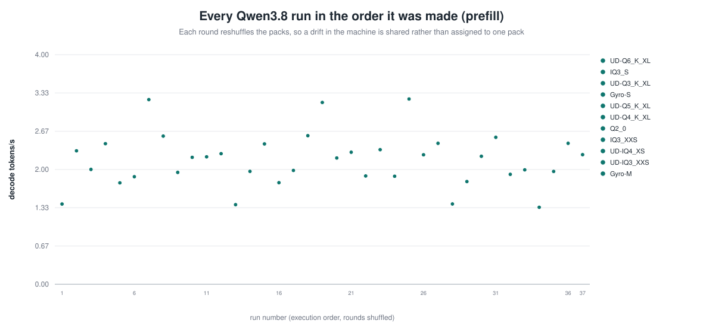

# Qwen3.8-Flash-Next quantisation benchmarks on macpro51 (RX 580, Metal 2)

_Generated 2026-11-18 22:04 UTC by `bench/macpro51/run_bench_qwen38.py` after every completed run. Every number below was produced on the machine named here._

## The machine

| | |
| --- | --- |
| Mac | MacPro5,1, 2 × 6-core Xeon X5675 (12 cores / 24 threads), 128 GB DDR3 ECC |
| GPU | AMD Radeon RX 580, 8 GB, Metal 2 (no Metal 3, no bf16, no device addresses) |
| OS | macOS 11.7.11 (Big Sur, 20G1443) |
| Engine | `strata` 0.1.59-metal (`metal/` build, Ninja Release), branch `macpro51` |
| Branch / commit at the last run | `macpro51` / `d2552f7f0e` |

The engine's Metal decode window reads the model's GGUF in place. The RX 580 cannot hold a 40–160 GB pack in 8 GB of VRAM, so the dense side (norms, hyper-connection projections, the shared expert and the attention/GDN projections) is read once into host memory and the routed experts stream from the SSD through an arena; a token's experts are looked up after its router and the next layer's are read ahead. Nothing is copied into a second file.

## What ran

Qwen3.8-Flash-Next (`qwen4exp`) is the shape the engine compiles for: 48 trunk layers (36 gated-DeltaNet, 12 full-attention QSA with the 4×128 indexer), 4 hyper-connection streams of rank 320, and 512 routed experts of width 640 with 10 used per token, plus the 28.8 GB PLE n-gram table in the second shard. Every pack below is the same architecture; only the expert encodings differ.

| Pack | Quantisation | Source | On disk | Result |
| --- | --- | --- | ---: | --- |
| `Q2_0` | Q2_0 (GSQ-RCO) | ISTA-DASLab | 61.9 GiB | 2 runs, 1.06 tok/s decode (steady state) |
| `IQ3_XXS` | IQ3_XXS (GSQ-RCO) | ISTA-DASLab | 70.6 GiB | 2 runs, 0.91 tok/s decode (steady state) |
| `IQ3_S` | IQ3_S (GSQ-RCO) | ISTA-DASLab | 77.9 GiB | 2 runs, 0.82 tok/s decode (steady state) |
| `UD-Q4_K_XL` | UD-Q4_K_XL (Unsloth) | unsloth | 103.7 GiB | 2 runs, 0.62 tok/s decode (steady state) |
| `UD-Q5_K_XL` | UD-Q5_K_XL (Unsloth) | unsloth | 120.5 GiB | queued |
| `IQ2_XS` | refused on this branch | — | 63.4 GiB | the window has no kernel for its IQ1_M gate/up experts: `mtl: no function moe_gu_29_32_1_4` |

Not on disk yet (not attempted, and not counted as a failure): `UD-IQ1_M`, `UD-Q2_0`, `UD-IQ2_XS`, `UD-Q2_K_XL`, `UD-IQ3_XXS`, `UD-Q3_K_XL`, `UD-IQ4_XS`, `UD-Q6_K_XL`, `Q8_0`.

## Method

- **One process per run.** `strata` opens the shard, builds the pack metadata once, reads the dense side and the expert arena, then times the prompt and the decode separately. Load time is reported on its own and is not part of either throughput.
- **Fixed workload.** The same 32 token ids for every pack (the Qwen 248 320-entry vocabulary, a varied English sentence rather than repeated ids, so routing is not narrowed), read one at a time, then 32 greedy tokens.
- **Mixed order.** Each round contains every downloaded pack once, in a fresh shuffled order (seed in the run's `meta.json`). No pack is always first or last, so thermal drift, page-cache state and SSD behaviour are spread across the matrix.
- **Error bars.** Mean ± 1 sample standard deviation over the steady-state runs (rounds 2+); round 1 is each pack's first pass and is priced separately. Individual runs are the dots on the charts.
- **Streaming.** `STRATA_METAL_STREAM=1` is set for every run: the pack cannot be resident in 8 GB of VRAM, and forcing the streamed path keeps every pack on the same code path.

## Decode throughput

| Pack | Steady runs | Decode, steady (mean ± sd) | All runs (mean) | Steady range | Prefill, steady (mean ± sd) |
| --- | ---: | ---: | ---: | ---: | ---: |
| `Q2_0` | 2 | 1.06 ± 0.003 | 1.06 | 1.06 – 1.06 | 3.38 ± 0.004 |
| `IQ3_XXS` | 2 | 0.913 ± 0.001 | 0.913 | 0.912 – 0.914 | 2.74 ± 0.032 |
| `IQ3_S` | 2 | 0.825 ± 0.000 | 0.825 | 0.824 – 0.825 | 2.42 ± 0.065 |
| `UD-Q4_K_XL` | 2 | 0.623 ± 0.000 | 0.623 | 0.623 – 0.623 | 1.97 ± 0.005 |

## Prompt (prefill) throughput

The prompt is read one token at a time on this port, so prefill here is per-token latency through the same expert stream, not the batched GEMM a CUDA card runs. It is comparable across these packs, not to a desktop GPU's numbers.

## Size against speed

A token reads only its 10 routed experts per layer, so a bigger file is not automatically slower: what matters is the bytes one token actually touches, the encoding's decode cost (Q2_0 and the i-quants trade a wider row read for cheap decode), and how much of the dense side stays resident.

## What the numbers say

- **Fastest decode:** `Q2_0` at 1.06 tok/s; **slowest:** `UD-Q4_K_XL` at 0.62 tok/s (1.70× between them).
- **Run-to-run spread:** coefficient of variation from 0.0% (`UD-Q4_K_XL`) to 0.3% (`Q2_0`).
- **Fastest prompt read:** `Q2_0` at 3.38 tok/s; slowest `UD-Q4_K_XL` at 1.97 tok/s.

The first round is the first pass over each pack (cold page cache, cold GPU clocks); the later rounds are the steady state. The difference is the price of a first run, not a property of the pack: it averages -0.1% over these 4 packs.

| Pack | Round 1 (tok/s) | Rounds 2+ (tok/s) | Change |
| --- | ---: | ---: | ---: |
| `Q2_0` | 1.06 | 1.06 | -0.4% |
| `IQ3_XXS` | 0.91 | 0.91 | -0.2% |
| `IQ3_S` | 0.82 | 0.82 | +0.1% |
| `UD-Q4_K_XL` | 0.62 | 0.62 | -0.1% |

## Run order (mixing)

The sweep is resumable: a `(round, pack)` pair already in `results-qwen38.jsonl` is skipped, so an interrupted or rebooted machine costs one run rather than the series.

## Per-run log

| # | Round | Pack | Prefill s | Decode s | Decode tok/s | Note |
| ---: | ---: | --- | ---: | ---: | ---: | --- |
| 1 | 1 | `IQ3_S` | 13.05 | 38.82 | 0.824 | first round (cold) |
| 2 | 1 | `Q2_0` | 9.17 | 30.07 | 1.06 | first round (cold) |
| 3 | 1 | `UD-Q4_K_XL` | 15.68 | 51.34 | 0.623 | first round (cold) |
| 4 | 1 | `IQ3_XXS` | 11.41 | 35.03 | 0.914 | first round (cold) |
| 5 | 2 | `IQ3_XXS` | 11.22 | 35.09 | 0.912 | later round |
| 6 | 2 | `IQ3_S` | 12.56 | 38.79 | 0.825 | later round |
| 7 | 2 | `UD-Q4_K_XL` | 15.74 | 51.37 | 0.623 | later round |
| 8 | 2 | `Q2_0` | 9.18 | 30.18 | 1.06 | later round |

## Limits recorded here

- The pack's second shard is the 28.8 GB PLE n-gram table. It is read from the SSD a few rows at a time and is never loaded whole; its size counts in the download, not in VRAM.
- Metal 2 on this card has no device addresses; kernels take buffer + offset, and the engine hands every weight that way. No Metal 3 feature is used.
- The output head is 512 wide in the draft path and 248 320 wide in the sample; greedy decoding is used throughout so the comparison is not a sampler's.

