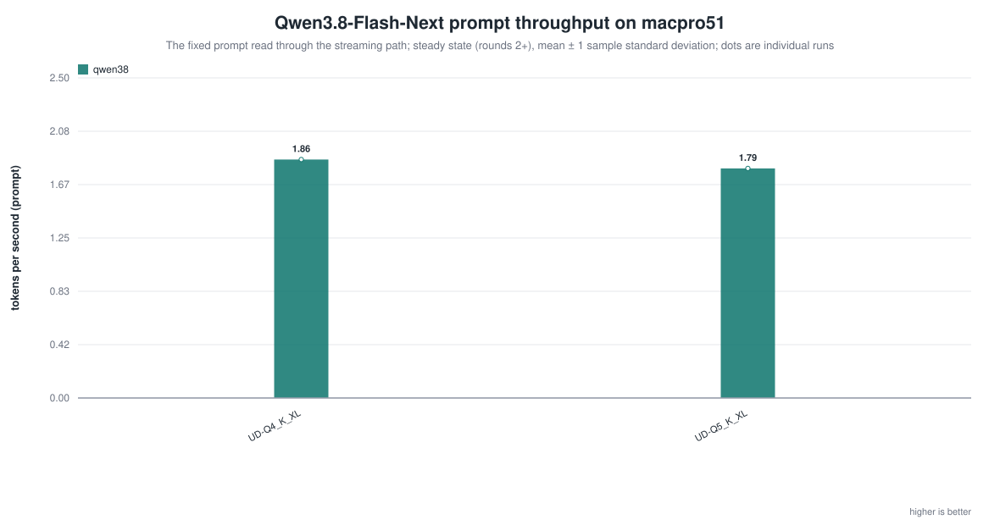
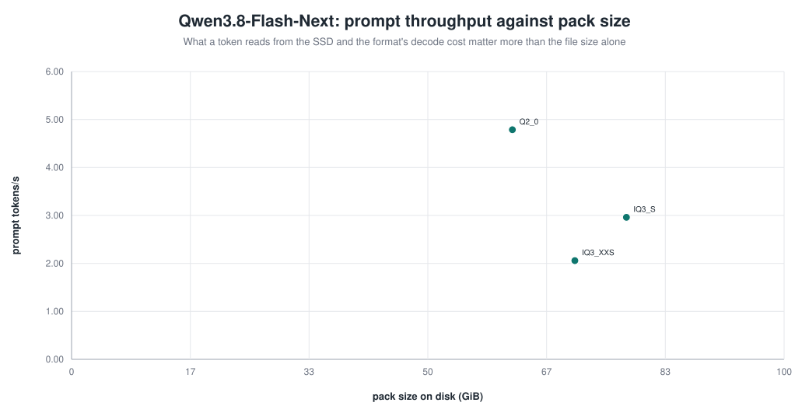

# Qwen3.8-Flash-Next prompt-throughput benchmarks on macpro51 (RX 580, Metal 2)

_Generated 2026-11-19 08:01 UTC by `bench/macpro51/run_bench_qwen38.py` after every completed run. Every number below was produced on the machine named here._

> **The engine does not answer yet.** Its forward pass goes non-finite at the first full-attention layer, so
> there is no decode rate to report and none is claimed here. What this page measures is the prompt path: the
> whole model is opened, the dense side and the expert arena are built, and the 32-token prompt is read through
> the same streaming kernels a decode window uses. Those bytes and that work are real. The blocker and the
> evidence are in [qwen38-metal-macpro51.md](qwen38-metal-macpro51.md); this page becomes the decode matrix
> the day the query projection is fixed.

## The machine

| | |
| --- | --- |
| Mac | MacPro5,1, 2 × 6-core Xeon X5675 (12 cores / 24 threads), 128 GB DDR3 ECC |
| GPU | AMD Radeon RX 580, 8 GB, Metal 2 (no Metal 3, no bf16, no device addresses) |
| OS | macOS 11.7.11 (Big Sur, 20G1443) |
| Engine | `strata` 0.1.59-metal, branch `macpro51` |
| Branch / commit at the last run | `macpro51` / `94724ce45f` |

## What ran

| Pack | Quantisation | Source | On disk | Runs | Prompt, steady (mean ± sd) | All runs (mean) | Steady range |
| --- | --- | --- | ---: | ---: | ---: | ---: | ---: |
| `Q2_0` | Q2_0 (GSQ-RCO) | ISTA-DASLab | 61.9 GiB | — | — | — | — |
| `IQ2_XS` | IQ2_XS (GSQ-RCO) | ISTA-DASLab | 63.4 GiB | — | — | — | — |
| `IQ3_XXS` | IQ3_XXS (GSQ-RCO) | ISTA-DASLab | 70.6 GiB | — | — | — | — |
| `IQ3_S` | IQ3_S (GSQ-RCO) | ISTA-DASLab | 77.9 GiB | — | — | — | — |
| `UD-IQ1_M` | UD-IQ1_M (Unsloth v3.1) | unsloth | 63.3 GiB | — | — | — | — |
| `UD-Q2_0` | UD-Q2_0 (Unsloth v3.1) | unsloth | 65.7 GiB | — | — | — | — |
| `UD-IQ2_XS` | UD-IQ2_XS (Unsloth v3.1) | unsloth | 70.6 GiB | — | — | — | — |
| `UD-Q2_K_XL` | UD-Q2_K_XL (Unsloth v3.1) | unsloth | 74.1 GiB | — | — | — | — |
| `UD-IQ3_XXS` | UD-IQ3_XXS (Unsloth v3.1) | unsloth | 77.9 GiB | — | — | — | — |
| `UD-Q3_K_XL` | UD-Q3_K_XL (Unsloth v3.1) | unsloth | 83.3 GiB | — | — | — | — |
| `UD-IQ4_XS` | UD-IQ4_XS (Unsloth v3.1) | unsloth | 87.2 GiB | — | — | — | — |
| `UD-Q4_K_XL` | UD-Q4_K_XL (Unsloth) | unsloth | 103.7 GiB | — | — | — | — |
| `UD-Q5_K_XL` | UD-Q5_K_XL (Unsloth) | unsloth | 147.4 GiB | — | — | — | — |
| `UD-Q6_K_XL` | UD-Q6_K_XL (Unsloth) | unsloth | 157.5 GiB | — | — | — | — |
| `Gyro-S` | Gyro-S (TQ1_0, agentionai) | agentionai | 54.5 GiB | — | — | — | — |
| `Gyro-M` | Gyro-M (TQ2_0, agentionai) | agentionai | 85.6 GiB | — | — | — | — |

Not on disk yet (not attempted, and not counted as a failure): `Q8_0`.

Refused on this branch (recorded, not timed):

| Pack | Why |
| --- | --- |
| `IQ2_XS` | the window has no kernel for its IQ1_M gate/up experts: `mtl: no function moe_gu_29_32_1_4` |
| `UD-Q2_0` | its greedy answer is `76 76 1544 7509 ...` where every other pack gives the reference tokens; its gate/up experts are IQ2_XXS (16), the same type as UD-IQ1_M's, and `expert_parity` passes on this pack's real layer-0 data at every GU tile |
| `UD-IQ2_XS` | its greedy answer is `4960 4654 1544 159578 ...`, not the reference tokens; a v3.1 set like UD-Q2_0 and UD-IQ1_M, whose expert formats are all used by the answering IQ3_XXS and IQ3_S packs |
| `UD-Q2_K_XL` | its greedy answer is `76 76 1544 7509 76 76 7509 88`, the v3.1 signature, where every working pack gives the reference tokens; its expert formats are all in the answering packs' set |
| `UD-IQ1_M` | runs, but its forward is degenerate (`76 76 1544 7509 4654 76 88 76`, first-token logits at cosine 0.16 to Q2_0's); the residual is healthy after layer 0 (0.177; Q2_0 0.181), still healthy after layer 1's attention (0.173; Q2_0 0.174, UD-Q4 0.170), and 15.1 after layer 1's expert dispatch (UD-Q4 0.348), then stays there.  The PLE block's own outputs (keyn/qn/gated/normW) match the healthy packs to three digits, the experts pass `expert_parity` on this pack's real data (rel L2 1.3e-7), and layer 1 uses the same expert types as layer 0 - so the fault is inside layer 1's routed/shared expert path (plan, gu, swiglu, down, combine), not the quantisation |

## Method

- **One process per run.** The engine reads the dense side (2.36 GB for Q2_0), fills the expert arena (2.2 GB),
  compiles its window kernels, then reads the 32-token prompt as one chunk through the prompt path.
- **The same 32 token ids** for every pack (the Qwen 248 320-entry vocabulary, a varied English sentence).
- **Mixed order.** Each round contains every downloaded pack once, in a fresh shuffled order (seed in
  `bench/macpro51/meta-qwen38.json`), so a drift in the machine is spread rather than assigned to one pack.
- **Error bars.** Mean ± 1 sample standard deviation over the steady-state runs (rounds 2+). Round 1 is each
  pack's first pass on a cold page cache and is kept separately. The dots on the chart are the individual runs.
- **Streaming.** `STRATA_METAL_STREAM=1`: the pack cannot be resident in 8 GB of VRAM, and every pack is measured
  on the same streamed path. The prompt path and the decode window read the same experts from the same arena.

## Prompt throughput

## Size against prompt speed

A prompt token reads the same 10 routed experts per layer a decode token does, so the pack's encoding and the
bytes a token actually touches decide this number more than the file size does.

## What the numbers say

_Not enough completed packs yet; this section fills in as the rounds finish._

## Run order (mixing)

The sweep is resumable: a `(round, pack)` pair already in `results-qwen38.jsonl` is skipped, so an interrupted
or rebooted machine costs one run rather than the series.

## Per-run log

| # | Round | Pack | Prompt tokens | Prompt s | Prompt tok/s | Note |
| ---: | ---: | --- | ---: | ---: | ---: | --- |
| 1 | 1 | `UD-Q6_K_XL` | 31 | 22.18 | 1.40 | first round (cold) |
| 2 | 1 | `IQ3_S` | 31 | 13.33 | 2.33 | first round (cold) |
| 3 | 1 | `UD-Q3_K_XL` | 31 | 15.49 | 2.00 | first round (cold) |
| 4 | 1 | `Gyro-S` | 31 | 12.65 | 2.45 | first round (cold) |
| 5 | 1 | `UD-Q5_K_XL` | 31 | 17.55 | 1.77 | first round (cold) |
| 6 | 1 | `UD-Q4_K_XL` | 31 | 16.55 | 1.87 | first round (cold) |
| 7 | 1 | `Q2_0` | 31 | 9.63 | 3.22 | first round (cold) |
| 8 | 1 | `IQ3_XXS` | 31 | 12.01 | 2.58 | first round (cold) |
| 9 | 1 | `UD-IQ4_XS` | 31 | 15.90 | 1.95 | first round (cold) |
| 10 | 1 | `UD-IQ3_XXS` | 31 | 14.02 | 2.21 | first round (cold) |
| 11 | 1 | `Gyro-M` | 31 | 13.96 | 2.22 | first round (cold) |
| 12 | 2 | `Gyro-M` | 31 | 13.62 | 2.28 | later round |
| 13 | 2 | `UD-Q6_K_XL` | 31 | 22.36 | 1.39 | later round |
| 14 | 2 | `UD-IQ4_XS` | 31 | 15.76 | 1.97 | later round |
| 15 | 2 | `Gyro-S` | 31 | 12.67 | 2.45 | later round |

