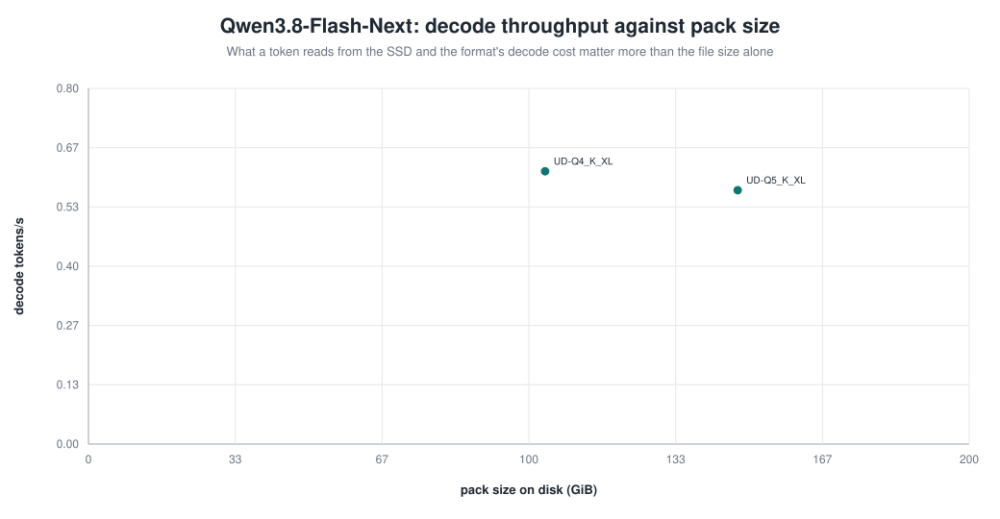
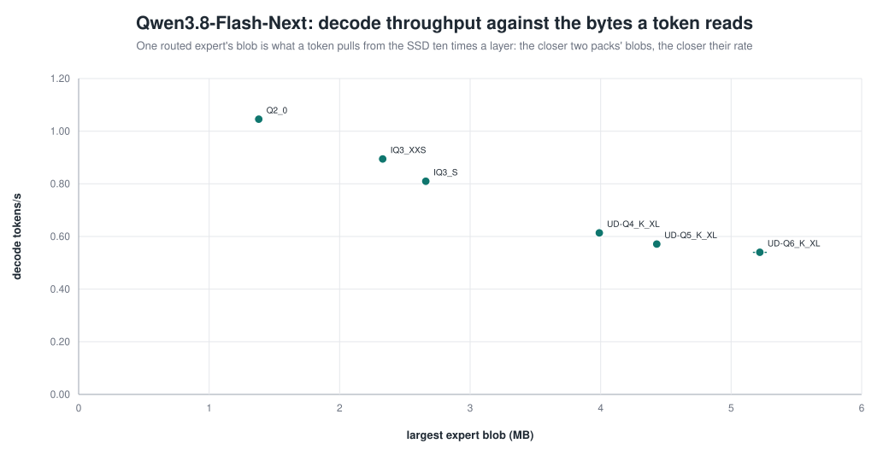

# Qwen3.8-Flash-Next quantisation benchmarks on macpro51 (RX 580, Metal 2)

_Generated 2026-11-19 10:55 UTC by `bench/macpro51/run_bench_qwen38.py` after every completed run. Every number below was produced on the machine named here._

## The machine

| | |
| --- | --- |
| Mac | MacPro5,1, 2 × 6-core Xeon X5675 (12 cores / 24 threads), 128 GB DDR3 ECC |
| GPU | AMD Radeon RX 580, 8 GB, Metal 2 (no Metal 3, no bf16, no device addresses) |
| OS | macOS 11.7.11 (Big Sur, 20G1443) |
| Engine | `strata` 0.1.59-metal (`metal/` build, Ninja Release), branch `macpro51` |
| Branch / commit at the last run | `macpro51` / `f813d27aa5` |

The engine's Metal decode window reads the model's GGUF in place. The RX 580 cannot hold a 40–160 GB pack in 8 GB of VRAM, so the dense side (norms, hyper-connection projections, the shared expert and the attention/GDN projections) is read once into host memory and the routed experts stream from the SSD through an arena; a token's experts are looked up after its router and the next layer's are read ahead. Nothing is copied into a second file.

## What ran

Qwen3.8-Flash-Next (`qwen4exp`) is the shape the engine compiles for: 48 trunk layers (36 gated-DeltaNet, 12 full-attention QSA with the 4×128 indexer), 4 hyper-connection streams of rank 320, and 512 routed experts of width 640 with 10 used per token, plus the 28.8 GB PLE n-gram table in the second shard. Every pack below is the same architecture; only the expert encodings differ.

| Pack | Quantisation | Source | On disk | Result |
| --- | --- | --- | ---: | --- |
| `Q2_0` | Q2_0 (GSQ-RCO) | ISTA-DASLab | 61.9 GiB | queued |
| `IQ3_XXS` | IQ3_XXS (GSQ-RCO) | ISTA-DASLab | 70.6 GiB | queued |
| `IQ3_S` | IQ3_S (GSQ-RCO) | ISTA-DASLab | 77.9 GiB | 1 run, 0.81 tok/s decode (steady state) |
| `UD-IQ3_XXS` | UD-IQ3_XXS (Unsloth v3.1) | unsloth | 77.9 GiB | queued |
| `UD-Q3_K_XL` | UD-Q3_K_XL (Unsloth v3.1) | unsloth | 83.3 GiB | 1 run, 0.71 tok/s decode (steady state) |
| `UD-IQ4_XS` | UD-IQ4_XS (Unsloth v3.1) | unsloth | 87.2 GiB | queued |
| `UD-Q4_K_XL` | UD-Q4_K_XL (Unsloth) | unsloth | 103.7 GiB | queued |
| `UD-Q5_K_XL` | UD-Q5_K_XL (Unsloth) | unsloth | 147.4 GiB | queued |
| `UD-Q6_K_XL` | UD-Q6_K_XL (Unsloth) | unsloth | 157.5 GiB | 1 run, 0.53 tok/s decode (steady state) |
| `Q8_0` | Q8_0 (Unsloth) | unsloth | 175.3 GiB | queued |
| `IQ2_XS` | refused on this branch | — | 63.4 GiB | the window has no kernel for its IQ1_M gate/up experts: `mtl: no function moe_gu_29_32_1_4` |
| `UD-Q2_0` | refused on this branch | — | 65.7 GiB | its greedy answer is `76 76 1544 7509 ...` where every other pack gives the reference tokens; its gate/up experts are IQ2_XXS (16), the same type as UD-IQ1_M's, and `expert_parity` passes on this pack's real layer-0 data at every GU tile |
| `UD-IQ2_XS` | refused on this branch | — | 70.6 GiB | its greedy answer is `4960 4654 1544 159578 ...`, not the reference tokens; a v3.1 set like UD-Q2_0 and UD-IQ1_M, whose expert formats are all used by the answering IQ3_XXS and IQ3_S packs |
| `UD-Q2_K_XL` | refused on this branch | — | 74.1 GiB | its greedy answer is `76 76 1544 7509 76 76 7509 88`, the v3.1 signature, where every working pack gives the reference tokens; its expert formats are all in the answering packs' set |
| `Gyro-S` | refused on this branch | — | 54.5 GiB | runs through the trellis expert path (no missing kernel) but its greedy answer does not match the reference: `198 18 18 18 18 18 18 18` in its own smoke, and the sweep runs diverge as well |
| `Gyro-M` | refused on this branch | — | 85.6 GiB | same: the TQ path runs and its greedy answer diverges from the reference |
| `UD-IQ1_M` | refused on this branch | — | 63.3 GiB | runs, but its forward is degenerate (`76 76 1544 7509 4654 76 88 76`, first-token logits at cosine 0.16 to Q2_0's); the residual is healthy after layer 0 (0.177; Q2_0 0.181), still healthy after layer 1's attention (0.173; Q2_0 0.174, UD-Q4 0.170), and 15.1 after layer 1's expert dispatch (UD-Q4 0.348), then stays there.  The PLE block's own outputs (keyn/qn/gated/normW) match the healthy packs to three digits, the experts pass `expert_parity` on this pack's real data (rel L2 1.3e-7), and layer 1 uses the same expert types as layer 0 - so the fault is inside layer 1's routed/shared expert path (plan, gu, swiglu, down, combine), not the quantisation |

## Method

- **One process per run.** `strata` opens the shard, builds the pack metadata once, reads the dense side and the expert arena, then times the prompt and the decode separately. Load time is reported on its own and is not part of either throughput.
- **Fixed workload.** The same 32 token ids for every pack (the Qwen 248 320-entry vocabulary, a varied English sentence rather than repeated ids, so routing is not narrowed), read one at a time, then 32 greedy tokens.
- **Mixed order.** Each round contains every downloaded pack once, in a fresh shuffled order (seed in the run's `meta.json`). No pack is always first or last, so thermal drift, page-cache state and SSD behaviour are spread across the matrix.
- **Error bars.** Mean ± 1 sample standard deviation over the steady-state runs (rounds 2+); round 1 is each pack's first pass and is priced separately. Individual runs are the dots on the charts.
- **Streaming.** `STRATA_METAL_STREAM=1` is set for every run: the pack cannot be resident in 8 GB of VRAM, and forcing the streamed path keeps every pack on the same code path.
- **The answer gate.** Every pack that works continues the prompt with the same first tokens (`271 248068 198 760`). A run whose greedy output starts elsewhere is not a slower quantisation, it is a pack that is not answering: it is excluded from the tables and marked in the log, because a rate for a wrong forward is worse than no rate.

## Decode throughput


| Pack | Steady runs | Decode, steady (mean ± sd) | All runs (mean) | Steady range | Prefill, steady (mean ± sd) |
| --- | ---: | ---: | ---: | ---: | ---: |
| `IQ3_S` | 1 | 0.814 ± 0.00 | 0.814 | 0.814 – 0.814 | 2.32 ± 0.00 |
| `UD-Q3_K_XL` | 1 | 0.708 ± 0.00 | 0.708 | 0.708 – 0.708 | 1.94 ± 0.00 |
| `UD-Q6_K_XL` | 1 | 0.528 ± 0.00 | 0.528 | 0.528 – 0.528 | 1.35 ± 0.00 |

## Prompt (prefill) throughput


The prompt is read one token at a time on this port, so prefill here is per-token latency through the same expert stream, not the batched GEMM a CUDA card runs. It is comparable across these packs, not to a desktop GPU's numbers.

## Size against speed



A token reads only its 10 routed experts per layer, so a bigger file is not automatically slower: what matters is the bytes one token actually touches, the encoding's decode cost (Q2_0 and the i-quants trade a wider row read for cheap decode), and how much of the dense side stays resident.

## The bytes a token reads



| Pack | Largest expert blob | Decode, steady |
| --- | ---: | ---: |
| `IQ3_S` | 2.66 MB | 0.814 ± 0.00 tok/s |
| `UD-Q3_K_XL` | 2.87 MB | 0.708 ± 0.00 tok/s |
| `UD-Q6_K_XL` | 5.22 MB | 0.528 ± 0.00 tok/s |

Every token pulls its ten routed experts per layer from the SSD, so the blob one expert costs is the number a token actually pays for; the pack file is mostly experts a token never asks for.  Two packs whose blobs are the same size land at nearly the same rate, which is why the Unsloth 4.5-bit set is slower than the 2-bit one even though their files differ by less than 2x.


## What the packs are made of

| Pack | Gate/up / down experts (layers) | Largest blob | Decode, steady |
| --- | --- | ---: | ---: |
| `IQ3_S` | IQ2_S / IQ4_NL (15), IQ3_XXS / IQ4_NL (14), IQ3_S / IQ4_NL (9), IQ2_S / Q2_0 (5), IQ3_XXS / Q2_0 (3), IQ3_S / Q2_0 (1), IQ4_XS / IQ4_NL (1) | 2.66 MB | 0.814 tok/s |
| `UD-Q3_K_XL` | IQ3_XXS / IQ4_NL (21), IQ3_XXS / Q5_0 (17), IQ4_XS / IQ4_NL (4), IQ2_S / Q2_0 (2), IQ4_XS / Q5_0 (2), IQ2_S / Q5_0 (1), IQ2_S / IQ4_NL (1) | 2.87 MB | 0.708 tok/s |
| `UD-Q6_K_XL` | Q6_K / Q8_0 (47), Q8_0 / Q8_0 (1) | 5.22 MB | 0.528 tok/s |

The formats are the packs' own metadata (`native_experts.txt`), and they are what the blob column is made of: the ISTA sets spend the same 2–3 bits on every expert of every layer, while the Unsloth UD sets mix formats layer by layer to keep the important ones wider.


## What the numbers say

- **Fastest decode:** `IQ3_S` at 0.81 tok/s; **slowest:** `UD-Q6_K_XL` at 0.53 tok/s (1.54× between them).
- **Fastest prompt read:** `IQ3_S` at 2.32 tok/s; slowest `UD-Q6_K_XL` at 1.35 tok/s.

## Run order (mixing)


The sweep is resumable: a `(round, pack)` pair already in `results-qwen38.jsonl` is skipped, so an interrupted or rebooted machine costs one run rather than the series.

## Per-run log

| # | Round | Pack | Prefill s | Decode s | Decode tok/s | Note |
| ---: | ---: | --- | ---: | ---: | ---: | --- |
| 1 | 1 | `UD-Q6_K_XL` | 22.97 | 60.62 | 0.528 | first round (cold) |
| 2 | 1 | `IQ3_S` | 13.37 | 39.31 | 0.814 | first round (cold) |
| 3 | 1 | `UD-Q3_K_XL` | 15.99 | 45.20 | 0.708 | first round (cold) |

## Reproduce

```sh
# the whole matrix (this is what wrote the page): 5 shuffled rounds, one commit per run
python3 bench/macpro51/run_bench_qwen38.py --rounds 5 --seed 20261118

# one pack, one run, the way the harness calls the engine
STRATA_METAL_STREAM=1 ./build-bench/strata --pack ~/models/qwen38/Q2_0/pack \
    --native ~/models/qwen38/Q2_0/Qwen3.8-Flash-Next-GSQ-RCO-Q2_0-00001-of-00002.gguf \
    --ple-gguf ~/models/qwen38/Q2_0/Qwen3.8-Flash-Next-GSQ-RCO-Q2_0-00002-of-00002.gguf \
    --tokens 814,20139,11,303,1330,2716,22157,11,3069,279,12515,5686,6105,2261,279,1834,321,2438,506,41564,13,4844,1910,3069,279,16820,5686,18016,3043,279,32946,13 \
    --max-new 32 --max-context 512 --spec 1 --suffix-draft 0 --lookup-max-t 0 --prefill 32
```

A multi-shard pack (the Unsloth sets) is joined first by `metal/tools/metal_repack.py` and packed with `tools/iq_pack.py --compat-bf16`; `bench/macpro51/prep_unsloth.sh <PACK>` does both and a smoke run. The repacked file is passed as `--native` **and** `--native-dense-gguf`.

## Limits recorded here

- The pack's second shard is the 28.8 GB PLE n-gram table. It is read from the SSD a few rows at a time and is never loaded whole; its size counts in the download, not in VRAM.
- Metal 2 on this card has no device addresses; kernels take buffer + offset, and the engine hands every weight that way. No Metal 3 feature is used.
- The output head is 512 wide in the draft path and 248 320 wide in the sample; greedy decoding is used throughout so the comparison is not a sampler's.
- Refused, with the reason on each row: `IQ2_XS` needs an IQ1_M expert kernel this branch does not have, and the Unsloth v3.1 sets (`UD-Q2_0`, `UD-IQ1_M`, `UD-IQ2_XS`, `UD-Q2_K_XL`) answer differently from every working pack - the defect is written up in [qwen38-metal-v3.1-refusal.md](qwen38-metal-v3.1-refusal.md), localised to layer 1's fold.

