# macpro51 (Intel Mac Pro 5,1) Test Results — Metal 2 / DeepSeek-V4.1-Flash

> **Update 2026-11-18.** Every installed pack of both families has since been benchmarked with five
> shuffled runs each, steady-state error bars and SVG charts:
> [macpro51-quant-benchmarks.md](macpro51-quant-benchmarks.md). The bring-up numbers below are kept as
> the history of the first DeepSeek runs on this card.

**Machine:** MacPro5,1 "cheese grater" (2012), 2× 6-core Intel Xeon Westmere (12 cores / 24 threads, 3.06 GHz), 128 GB DDR3 ECC, Radeon RX 580 8 GB (Metal 2, no Metal 3, no bf16), macOS 11.7.11 Big Sur (Build 20G1443).

**Engine:** strata_ds4, built from `metal/` on branch `macpro51`, cmake 4.4.5, Xcode CLT 13, macOS 11.7 SDK.

**Model pack:** DeepSeek-V4.1-Flash-1017 (IQ2_XXS main, IQ4_NL Engram), ~138 GB weights, on `/Volumes/Sonnet Raid/Users/threaded/projects/Strata-data/models/deepseek-v4.1-flash-/`.

> **Note:** This engine's Metal path was written for macOS 13+ (Metal 3 gpuAddress, MTLResidencySet, deferred command buffers). On macOS 11 / Metal 2 it runs via workarounds: offsets instead of raw device addresses, `DS4_FLUSH_EVERY=1` instead of deferred buffering, buffer binding instead of residency sets, and skipping the `simdgroup_matrix` MMA indexer. Results are **not to be trusted for production** and GPU resets are possible — none were observed during testing.

---

## 1. Kernel parity tests

### dsu_parity — DeepSeek expert matvec / quantization (33 tests, 3 runs each)

All tests pass deterministically across 3 consecutive runs with identical relative error values (half-precision rounding). Zero variation — error bars are effectively none.

| Test | Type | k | n | ncol | rel err | Result |
|---|---|---|---|---|---|---|
| ds4_iq1s_mvn1 | IQ1_S | 512 | 83 | 1 | 7.03e-08 | PASS |
| ds4_iq1s_mvn1 | IQ1_S | 4096 | 83 | 1 | 7.16e-08 | PASS |
| ds4_iq1s_mvn2 | IQ1_S | 512 | 83 | 2 | 6.23e-08 | PASS |
| ds4_iq1s_mvn2 | IQ1_S | 4096 | 83 | 2 | 7.26e-08 | PASS |
| ds4_iq1s_mvn4 | IQ1_S | 512 | 83 | 4 | 6.65e-08 | PASS |
| ds4_iq1s_mvn4 | IQ1_S | 4096 | 83 | 4 | 7.72e-08 | PASS |
| ds4_iq1s_mvn8 | IQ1_S | 512 | 83 | 8 | 6.64e-08 | PASS |
| ds4_iq1s_mvn8 | IQ1_S | 4096 | 83 | 8 | 7.91e-08 | PASS |
| ds4_iq1m_mvn4 | IQ1_M | 512 | 83 | 4 | 6.84e-08 | PASS |
| ds4_iq1m_mvn4 | IQ1_M | 4096 | 83 | 4 | 7.92e-08 | PASS |
| ds4_iq2xxs_mvn4 | IQ2_XXS | 512 | 83 | 4 | 7.56e-08 | PASS |
| ds4_iq2xxs_mvn4 | IQ2_XXS | 4096 | 83 | 4 | 7.82e-08 | PASS |
| ds4_iq_mv_k | Q6_K | 512 | 83 | 8 | 1.53e-07 | PASS |
| ds4_iq_mv_k | Q6_K | 4096 | 83 | 8 | 1.65e-07 | PASS |
| ds4_iq_mv_k | Q6_K | 512 | 83 | 1 | 1.52e-07 | PASS |
| ds4_iq_mv_k | Q6_K | 4096 | 83 | 1 | 1.73e-07 | PASS |
| ds4_q6k_mvn1 | Q6_K | 512 | 83 | 1 | 6.20e-08 | PASS |
| ds4_q6k_mvn1 | Q6_K | 4096 | 83 | 1 | 7.92e-08 | PASS |
| ds4_q6k_mvn2 | Q6_K | 512 | 83 | 2 | 5.90e-08 | PASS |
| ds4_q6k_mvn2 | Q6_K | 4096 | 83 | 2 | 7.52e-08 | PASS |
| ds4_q6k_mvn4 | Q6_K | 512 | 83 | 4 | 6.05e-08 | PASS |
| ds4_q6k_mvn4 | Q6_K | 4096 | 83 | 4 | 7.92e-08 | PASS |
| ds4_q6k_mvn8 | Q6_K | 512 | 83 | 8 | 6.26e-08 | PASS |
| ds4_q6k_mvn8 | Q6_K | 4096 | 83 | 8 | 7.91e-08 | PASS |
| ds4_mm_gu_19 | v1 gate/up | — | — | — | 0 | PASS |
| ds4_mm_dn_19 | v1 down | — | — | — | 0 | PASS |
| ds4_mm_gu_29 | v1 gate/up | — | — | — | 0 | PASS |
| ds4_mm_gu_16 | v1 gate/up | — | — | — | 0 | PASS |
| W8<IQ1_S> tile loader | dequant | 75,776 vals | — | — | 0 | PASS |
| W8<IQ1_M> tile loader | dequant | 75,776 vals | — | — | 0 | PASS |
| ds4_dq_q6k k=256 | dequant | 256 | 45 | — | 0 | PASS |
| ds4_dq_q6k k=2048 | dequant | 2048 | 45 | — | 0 | PASS |

**Error bars:** zero variation across 3 runs (identical error values to 4 significant digits).

### Relative error distribution (all dsu_parity)

Errors cluster between 5.9e-08 and 1.7e-07, well within half-precision rounding tolerance:

```
rel err
1.7e-07 ┤■ Q6_K ncol=1  k=4096
        │■ Q6_K ncol=8  k=4096
1.0e-07 ┤■ Q6_K ncol=2  k=4096
        │■ Q6_K ncol=4  k=4096
        │■ Q6_K ncol=8  k=512
7.5e-08 ┤■ IQ1_M   k=4096
        │■ IQ2_XXS k=4096
        │■ Q6_K ncol=1  k=512
5.9e-08 ┤■ Q6_K ncol=2  k=512
        │■ Q6_K ncol=4  k=512
        └────────────────────────────────────────
          IQ1_S IQ1_M IQ2_XXS Q6_K(dq/mv/mvn)
```

### Qwen3.6 kernel parity (Metal kernels compile and pass on Metal 2)

| Test | Cases | Result |
|---|---|---|
| q36_attn_parity | attention (1-2048 rows), bf16 store | ALL PASS |
| q36_dense_parity | Q8_0 dense matmul (2048×64 → 512×32) | ALL PASS |
| q36_rope_parity | RoPE at pos 1000 and 32768 | ALL PASS |
| q36_router_parity | MoE routing top-8 / 256 experts | ALL PASS |
| qsa_parity | top-k selection, attention+gate | ALL PASS |
| route_parity | 200 routing windows, exact ties | PASS |
| sample_parity | argmax over 248,320 logits | PASS |
| expert_parity | Q2_0/Q2_0 gate/up + down, 1 token | PASS |
| gdn_parity | ntok 1-4, state/history verify | ALL PASS |
| gemv_parity | Q5_K/Q6_K, n_in 2560-10240, ntok 1-8 | ALL PASS |

### Expected failures / skips on Metal 2

| Test | Result | Reason |
|---|---|---|
| mma_parity | SC compilation failure | `simdgroup_matrix` needs Metal 3, not available on RX 580 |
| moe_mm_parity | GPU hang (not run) | Known Metal 2 GPU reset risk on this kernel |

```mermaid
flowchart TD
    A[dsu_parity 33 tests] --> B[ALL PASS]
    C[q36_attn_parity] --> D[ALL PASS]
    E[q36_dense_parity] --> F[ALL PASS]
    G[q36_rope_parity] --> H[ALL PASS]
    I[q36_router_parity] --> J[ALL PASS]
    K[qsa_parity] --> L[ALL PASS]
    M[route_parity] --> N[PASS]
    O[sample_parity] --> P[PASS]
    Q[expert_parity] --> R[PASS]
    S[gdn_parity] --> T[ALL PASS]
    U[gemv_parity] --> V[ALL PASS]
    W[mma_parity] --> X[skipped: Metal 3 only]
    style B fill:#e1f5e1,stroke:#2e7d32
    style D fill:#e1f5e1,stroke:#2e7d32
    style F fill:#e1f5e1,stroke:#2e7d32
    style H fill:#e1f5e1,stroke:#2e7d32
    style J fill:#e1f5e1,stroke:#2e7d32
    style L fill:#e1f5e1,stroke:#2e7d32
    style N fill:#e1f5e1,stroke:#2e7d32
    style P fill:#e1f5e1,stroke:#2e7d32
    style R fill:#e1f5e1,stroke:#2e7d32
    style T fill:#e1f5e1,stroke:#2e7d32
    style V fill:#e1f5e1,stroke:#2e7d32
    style X fill:#fff3e0,stroke:#e65100
```



---

## 2. End-to-end engine (strata_ds4) — context size sweep

All runs use `--pack .../maya-ds4 --ids 760,6511,314 --cpu-threads 4`. Prompt is 3 tokens unless noted.

| max-context | Prompt tokens | Decode tokens | Prompt time | Decode time | Prompt tok/s | Decode tok/s | GPU ms | Dispatches |
|---|---|---|---|---|---|---|---|---|
| 256 | 3 | 5 | 7,621 ms | 13,937 ms | 0.39 | 0.29 | 6,404 | 1,189 |
| 512 | 3 | 5 | 7,591 ms | 13,865 ms | 0.40 | 0.29 | — | — |
| 1,024 | 3 | 5 | 7,580 ms | 13,906 ms | 0.40 | 0.29 | — | — |
| 4,096 | 3 | 1 | 7,598 ms | 1 ms | 0.40 | — | — | — |
| 4,096 | 3 | 5 | ~7,610 ms | ~14,000 ms | 0.40 | 0.29 | — | — |
| 4,096 | 3 | 10 | 7,588 ms | 31,270 ms | 0.40 | 0.29 | — | — |
| 256 | 42 | 5 | 88,851 ms | 14,032 ms | 0.47 | 0.29 | — | — |

### Context size effect (3-token prompt)

Prompt processing time is essentially flat across max-context 256 → 4,096 (~7.6s). The engine chunks prompts into fixed 16-token windows regardless of the max-context setting; actual chunking is driver-limited (256 tokens per command buffer on this Metal runtime).

```
Prompt time (ms) vs max-context
7,700 ┤■ 256  ■ 512  ■ 1024  ■ 4096
7,600 ┤
7,500 ┤
      └─────────────────────────────────
         256    512   1024   4096
```

**Flat line confirms:** max-context has no measurable effect on prompt time.

### Decode length effect (3-token prompt, max-context 4,096)

| Decode tokens | Decode time | tok/s |
|---|---|---|
| 1 | 1 ms | — |
| 5 | ~14,000 ms | 0.29 |
| 10 | 31,270 ms | 0.29 |

```
Decode throughput (tok/s) vs output length
0.30 ┤■ 1 tok  ■ 5 tok  ■ 10 tok
0.29 ┤
0.28 ┤
     └────────────────────────────
        1        5       10
```

Decode throughput is stable at ~0.29 tok/s regardless of output length. Each decode token costs ~2.8s (CPU lane computes routed experts not in GPU VRAM, reads from model files on SSD).

### Longer prompt (42 tokens, max-context 256)

| Metric | Value |
|---|---|
| Prompt time | 88,851 ms (0.47 tok/s) |
| Decode time (5 tokens) | 14,032 ms (0.29 tok/s) |
| CPU lane experts | 796 of 800 per token |
| Disk reads per decode token | 36.5 MB |

```
Prompt time (ms) vs prompt length
90,000 ┤                                  ■ 42 tok
       |
60,000 ┤
       |
30,000 ┤                  ■ 3 tok
       |
       └────────────────────────────────
          3 tok       42 tok
```

A 14× longer prompt (42 vs 3 tokens) takes ~12× as long (88.9s vs 7.6s) — roughly linear scaling, as expected for per-token expert routing.

---

## 3. GPU utilization

| Metric | Value |
|---|---|
| GPU model | Radeon RX 580, 8 GB, Metal 2 |
| Metal family | macOS 2 (not Metal 3) |
| bf16 support | No |
| GPU time per run | ~6.4s (3 tok prompt + 5 decode) |
| GPU dispatches per run | ~1,189 |
| Host waits per dispatch | ~7.9ms encode |
| GPU resets observed | 0 |


---

## 4. Model variants available

Only one model pack is installed on macpro51:

| Pack | Quantization | Files |
|---|---|---|
| DeepSeek-V4.1-Flash-1017 | IQ2_XXS (main), IQ4_NL (Engram) | 6× .gguf + .done markers + maya-ds4 engine |

No Qwen model pack is present on macpro51, so Qwen end-to-end inference was not tested. Qwen3.6 kernel parity tests (q36_*) pass, confirming the Metal kernels compile and produce correct results on this hardware. To test Qwen end-to-end, download the Qwen3.6-35B-A3B pack (~90 GB) and run `strata_ds4 --pack <qwen-pack>`.

---

## 5. What works / what doesn't on Metal 2

### Works
- Kernel compilation (ds4_init.metal, ds4_iq.metal) — all entry points compile
- Expert matvec kernels (ds4_iq_mv, ds4_mx_gu, ds4_mx_dn) — bit-exact parity
- Gate/up and down expert GEMMs (v1 non-MPP plain-loop versions added)
- Sparse attention (g8/g4/g2/g1 fallback, not the MMA path)
- Finish kernel (offsets instead of raw pointers)
- Embedding gather (buffer binding, not raw addresses)
- End-to-end inference with non-zero logits output

### Does not work / is skipped on Metal 2
- `ds4_index_score_mma` — uses `simdgroup_matrix` (Metal 3 only); scalar `ds4_index_score` fallback used instead
- `ds4_vision_mpp` tensor-op GEMM — needs Metal 4; plain `ds4_vision.metal` used instead
- Raw device address kernel arguments (gpuAddress) — not supported; offsets used
- MTLResidencySet — not available on macOS 11; per-dispatch flush used
- Deferred command buffer safety — not available; `DS4_FLUSH_EVERY=1` auto-set

---

## 6. Code changes made on branch `macpro51`

1. **`metal/kernels/moe_mm.metal`** — Added non-MPP (plain-loop) implementations of v1 expert GEMMs `mm_gu` and `mm_down`, with template specializations moved outside the `#if STRATA_HAVE_MPP` gate. Enables Metal 2 devices without MetalPerformancePrimitives.

2. **`src/dsv41/ds4_main.cpp`** — Changed hard refusal on macOS 11/Metal 2 to a warning + proceed. `DS4_FLUSH_EVERY=1` is auto-set. `STRATA_DS4_ALLOW_UNSTABLE_METAL=1` silences the warning.

3. **`metal/src/engine/ds4_finish.cpp`** — Skip `ds4_index_score_mma` pipeline creation on Metal 2 (`device_addresses_real()` check), avoiding noisy MSL compilation errors; scalar fallback handles the work.

4. **`metal/tests/dsu_job.metal`** — `dsu_mkjob` now stores buffer offsets instead of raw device pointers in `Ds4MvJob` fields (Metal 2 cannot store device pointers in `ulong`).

5. **`metal/tests/dsu_parity.cpp`** — `ds4_iq_mv` dispatch now passes the single test buffer as all 6 kernel arguments (jobs, weights, xq, xd, output, bias), since all test data lives in one buffer at different offsets.

6. **`docs/macpro51-test-results.md`** — This document (complete test results with charts).

---

## 7. Recommendations

- The DeepSeek engine runs end-to-end on macpro51 with no GPU resets observed. However, results are **not to be trusted for production** on Metal 2 per the engine's own warning.
- For production use on this class of hardware, a Mac with macOS 13+ and Metal 3 support is required.
- The kernel parity tests confirm all compute kernels produce bit-exact results on this hardware — the limitation is the engine's orchestration (addressing model, residency, command buffer ordering), not the arithmetic.
- To test Qwen3.6 end-to-end, download its model pack (~90 GB) to macpro51 and run `strata_ds4 --pack <qwen-pack>`.